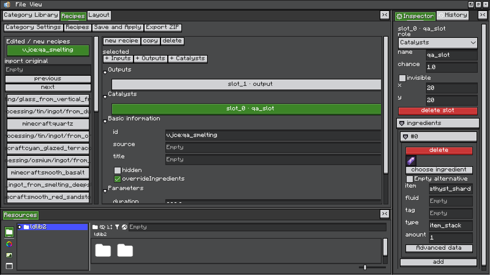
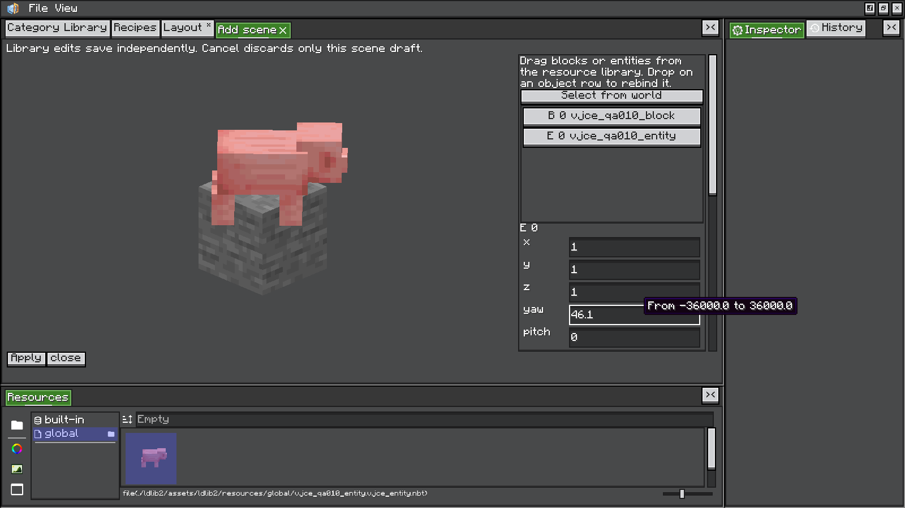
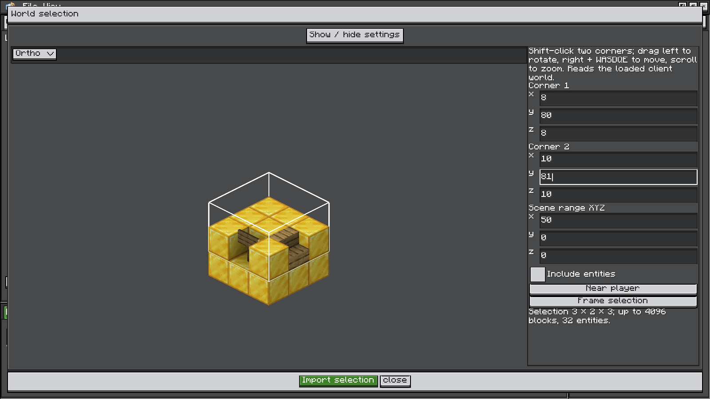
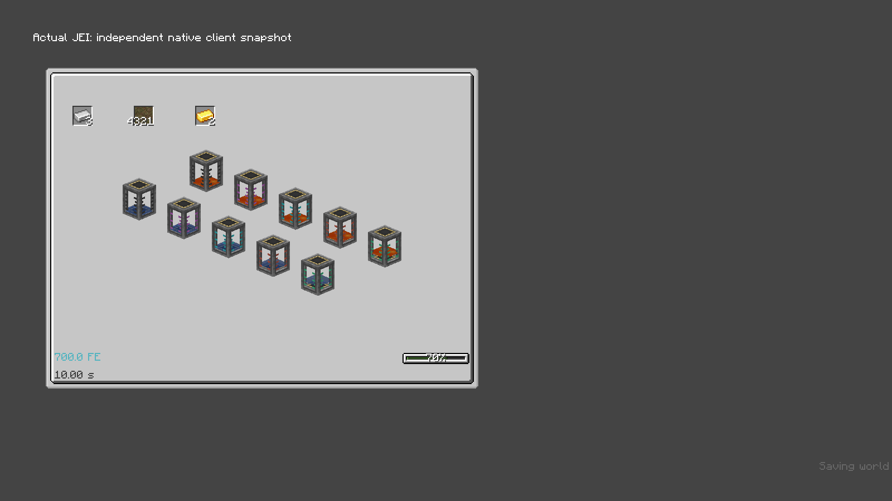

<div align="center">

# Visual JEI Category Editor

**把 JEI 配方页变成你的设计画布。**<br>
**Make JEI recipe pages your canvas.**


[简体中文](#简体中文) · [English](#english) ·
[进阶指南 / Advanced guide](docs/GUIDE.zh-CN.md)

</div>



---

## 简体中文

**VJCE** 是基于 [LDLib2](https://github.com/Low-Drag-MC/LDLib2) 的游戏内可视化
[JEI](https://github.com/mezz/JustEnoughItems) 分类与展示配方编辑器。
面向整合包作者和模组开发者，你可以新建分类、调整已有配方页面，
把方块、实体和世界快照放进 JEI，再将工程与资源一起导出。

> **展示与实际配方**：所有编辑作用于客户端 JEI 展示。
> 实际合成、机器处理和服务端配方仍由原模组或你的配方脚本决定。服务器无需安装 VJCE。

[功能亮点](#功能亮点) · [安装](#安装) · [快速开始](#快速开始) ·
[常用操作](#常用操作) · [导出与分享](#导出与分享) · [兼容说明](#兼容说明) · [开发](#开发)

### 功能亮点

| 能力 | 可以做什么 |
| --- | --- |
| **分类与配方** | 搜索已注册 JEI 分类，新建分类或覆盖已有页面，配置标题、图标、催化物和展示数据。 |
| **可视化画布** | 选择、移动、缩放、旋转与组合元素，配合对齐参考线、属性检视和撤销重做调整布局。 |
| **原料与槽位** | 从 JEI 拖入原料，编辑角色、候选项、数量和概率；支持物品、流体及已注册的其他原料类型。 |
| **三维场景** | 拖入方块和实体，或从世界框选独立快照，展示方块实体、装备、姿态和原生动画。 |
| **数据绑定** | 用自定义字段和表达式驱动文字、进度、颜色及可见性，展示能量、温度等参数。 |
| **工程与资源** | 保存可继续编辑的 `.vjce` 工程，管理全局方块／实体资源，并导出整合包 ZIP。 |

<details>
<summary><strong>更多实机画面：三维场景、世界框选与 JEI 效果</strong></summary>

**场景编辑** — 从资源管理器拖入方块和实体，在独立编辑页调整实例。



**世界框选** — 在大预览中选取结构，保存客户端可读取的方块与实体状态。



**实际 JEI** — 导入的流体储罐保留液体显示和等级外框颜色。



截图来自已有功能验收，开发与验收环境见下方安装说明。

</details>

### 安装

使用 **Minecraft 1.21.1 + Java 21 + NeoForge**，将 VJCE 的模组 JAR
及两个必需前置放入客户端实例的 `mods/` 文件夹。源码 JAR 不用于安装。

| 组件 | VJCE 声明的最低要求（无上限） | 开发／验收版本 |
| --- | --- | --- |
| NeoForge | `>= 21.1.216`，适用于 Minecraft 1.21.1 | `21.1.248`、`21.1.262` |
| LDLib2 | `>= 2.2.44` | `2.2.44`，NeoForge 1.21.1 **all** 发行包 |
| JEI | `>= 19.64.0.455` | `19.70.0.464` |

表中为 VJCE 自身的依赖声明；实际安装还需满足所选依赖各自的要求。
例如 JEI `19.64.0.455` 自身要求 NeoForge `21.1.238+`。
放宽后的 JEI 下限已核对 API 和关键 Mixin 签名，尚未新增旧版组合的实机验收。
编译依赖仍固定为原开发版本；取消上限不代表所有后续版本都已验证兼容。
LDLib2 `2.2.44` 提供当前编辑器必需接口，因此保留其下限。
已检查的 JEI `19.64.0.455` 官方制品另有 Minecraft 版本声明冲突，
具体安装限制见 [依赖元数据说明](docs/GUIDE.zh-CN.md#依赖元数据说明)。

**可选集成**：Mekanism `1.21.1-10.7.19.85`、Create `6.0.11-320` 已有验收记录。
Create 机械动画预设需要安装 Create 及其自身前置；普通方块、实体和世界快照无需 Create。
MBD2 是编辑器交互的参考项目，无需安装。

### 快速开始

1. **打开编辑器**：进入世界，在聊天栏输入 `/vjce editor`。
2. **选择分类**：在“分类库”中新建分类，或搜索已有 JEI 分类并创建覆盖工程。
3. **编辑数据**：设置分类 ID、标题、图标与页面尺寸；在“配方数据”中点击槽位，
   通过右侧检视面板编辑候选原料及其属性。
4. **设计页面**：切到“页面布局”，调整槽位、文字和装饰；点击“添加场景”可加入三维内容。
5. **预览并应用**：点击播放按钮检查页面，再点击“保存并应用”。
   **退出并重新进入世界后，JEI 才会应用新配置。**
6. **保留工程**：使用 `File → Save` 保存 `.vjce` 工程，方便继续编辑；发布时导出整合包 ZIP。

想先体验一个现成分类？将 [examples/](examples/) 内的 `config/` 复制到实例根目录，
然后进入世界。此示例只演示 JEI 展示，不注册实际合成配方。

### 常用操作

| 操作 | 行为 |
| --- | --- |
| 左键单击 | 选中组件或配方背景 |
| `Alt` + 单击 | 循环选择重叠组件和原生图层 |
| `Shift` + 左键拖动 | 移动组件 |
| 拖动完全空白处 | 平移画布 |
| `Ctrl` + 单击 | 进入绿色变换框模式，松开 `Ctrl` 后保持 |
| 拖动绿色框边缘／四角 | 调整尺寸；`Ctrl` + 拖四角等比例缩放 |
| 绿色模式中 `Alt` + 左键拖动内部 | 绕中心旋转；同时按 `Shift` 时以 15° 吸附 |
| `Esc` | 取消当前拖动；未拖动时退出绿色模式 |

移动与拉伸带有对齐参考线。更多手势、控件绑定、表达式、文件格式及场景限制见
[中文进阶指南](docs/GUIDE.zh-CN.md)。

### 导出与分享

点击“导出整合包 ZIP”，或执行：

```mcfunction
/vjce export
```

输出为 `exports/vjce-modpack.zip`，解压到目标整合包的**实例根目录**。
导出内容包括分类运行配置、已保存工程，以及 LDLib2 管理的外部贴图和场景资源。
接收方仍需安装 VJCE、必需前置及资源引用的其他模组。

| 路径／格式 | 用途 |
| --- | --- |
| `config/vjce/categories/*.json` | JEI 分类、展示配方、绑定和布局配置 |
| `.vjce` | 可继续编辑的工程文件 |
| `config/vjce/editor.json` | 编辑器外观、窗口及分栏偏好 |
| `exports/vjce-modpack.zip` | 可分发的整合包配置与资源 |

### 兼容说明

- **原版分类**：已适配工作台、切石、熔炼、烟熏、高炉、营火、锻造、酿造、铁砧、砂轮、燃料和堆肥，共 12 类。
- **第三方分类**：支持通用页面读取，已验收 Mekanism 的 30 个机器分类。
  新增／复制任意第三方配方、特殊控件的交互及内部三维绘制仍取决于具体适配。
  无法安全解析的页面保留只读原页；缺少稳定配方 ID 时限制单条数据覆盖。
- **配方填充**：仅改布局时沿用来源填充逻辑；覆盖展示原料或追加展示配方时禁用填充，避免与真实配方不一致。
- **世界快照**：每场景最多 4096 个方块、32 个实体，框选每轴最多 32 格。
  只能保存客户端已同步的数据；重新导入会替换旧方块和实体列表，即使未勾选导入实体也会清空旧实体。

### 开发

需要 JDK 21，项目自带 Gradle Wrapper：

```powershell
# Windows：构建与启动开发客户端
.\gradlew.bat build
.\gradlew.bat runClient

# 游戏内 UI 验证
.\gradlew.bat runClient -PuiTest
```

```bash
# Linux / macOS
sh ./gradlew build
sh ./gradlew runClient
```

模组 JAR 与源码 JAR 输出到 `build/libs/`。构建版本由 `gradle.properties` 的
`mod_version` 指定，模组元数据见 `src/main/resources/META-INF/neoforge.mods.toml`。
UI 测试会启动隔离测试世界，并在 `build/ui-test/` 输出报告和截图。
构建说明及可选模组验证命令见 [进阶指南](docs/GUIDE.zh-CN.md#构建与验证)。

---

## English

**VJCE** is an in-game visual [JEI](https://github.com/mezz/JustEnoughItems) category
and display recipe editor built with [LDLib2](https://github.com/Low-Drag-MC/LDLib2).
Create categories, redesign existing recipe pages, add blocks, entities and world snapshots,
then export your projects and resources for a modpack.

> **Display and processing:** edits affect client-side JEI presentation.
> Actual crafting, machine processing and server recipes remain controlled by the original mod
> or your recipe scripts. VJCE is not required on the server.

[Features](#features) · [Installation](#installation) · [Quick start](#quick-start) ·
[Controls](#controls) · [Export and share](#export-and-share) ·
[Compatibility](#compatibility) · [Development](#development)

### Features

| Feature | What you can do |
| --- | --- |
| **Categories and recipes** | Browse JEI categories, create your own or override pages; configure titles, icons, catalysts and display data. |
| **Visual canvas** | Select, move, resize, rotate and group elements with alignment guides, an inspector, and undo/redo. |
| **Ingredients and slots** | Drag ingredients from JEI and edit roles, alternatives, amounts and chances; use items, fluids and other registered types. |
| **3D scenes** | Arrange blocks and entities or capture world snapshots, including block entities, equipment, poses and native animations. |
| **Data bindings** | Drive text, progress, color and visibility with custom fields and expressions for energy, temperature and other values. |
| **Projects and resources** | Save editable `.vjce` projects, manage shared block/entity resources and export a modpack ZIP. |

<details>
<summary><strong>In-game gallery: scenes, world selection and JEI output</strong></summary>

**Scene editor** — Drag blocks and entities from the resource browser into a dedicated scene tab.


**World selection** — Capture a structure and the block/entity state available to the client.


**Actual JEI output** — Imported fluid tanks retain their contents and tier colors.


These screenshots come from previous feature validation runs.
Development and validation versions are listed in Installation below.

</details>

### Installation

Use **Minecraft 1.21.1, Java 21 and NeoForge**. Place the VJCE mod JAR and both
required dependencies in the client's `mods/` folder. Do not install the sources JAR.

| Component | VJCE minimum declaration (no upper bound) | Development / validation versions |
| --- | --- | --- |
| NeoForge | `>= 21.1.216`, for Minecraft 1.21.1 | `21.1.248`, `21.1.262` |
| LDLib2 | `>= 2.2.44` | `2.2.44`, NeoForge 1.21.1 **all** distribution |
| JEI | `>= 19.64.0.455` | `19.70.0.464` |

These are VJCE's own declarations; the selected dependencies also enforce their own requirements.
For example, JEI `19.64.0.455` requires NeoForge `21.1.238+`.
The lower JEI baseline has been checked against API references and key Mixin signatures;
the older combinations have not received new in-game validation.
Compile dependencies remain pinned. Removing upper bounds does not verify every later release.
LDLib2 `2.2.44` provides required editor APIs, so its minimum is retained.
The inspected official JEI `19.64.0.455` artifact also has conflicting Minecraft metadata;
see the [dependency metadata notes](docs/GUIDE.zh-CN.md#依赖元数据说明) (Chinese).

**Optional integrations:** Mekanism `1.21.1-10.7.19.85` and Create `6.0.11-320`
have recorded validation runs. Create animation presets require Create and its dependencies;
ordinary block scenes, entities and world snapshots work without Create.
MBD2 inspired the editor workflow and is not a dependency.

### Quick start

1. **Open the editor:** enter a world and run `/vjce editor` in chat.
2. **Choose a category:** create one in **Category Library**, or search for an existing
   JEI category and create an override project.
3. **Edit data:** set the category ID, title, icon and page size. In **Recipes**, select
   a slot and use the right-hand inspector to edit its ingredients and properties.
4. **Design the page:** open **Layout** to arrange slots, text and decoration.
   Use **Add scene** to include 3D content.
5. **Preview and apply:** use the play button, then **Save and Apply**.
   **Leave and re-enter the world for JEI to apply the saved configuration.**
6. **Keep your project:** use `File → Save` to save an editable `.vjce` file.
   Export a modpack ZIP when ready to share.

To try the included category, copy the `config/` folder from [examples/](examples/)
into your instance root before entering a world.
The example provides JEI display data; it does not register a crafting recipe.

### Controls

| Action | Result |
| --- | --- |
| Left-click | Select an element or the recipe background |
| `Alt` + click | Cycle through overlapping elements and native layers |
| `Shift` + left-drag | Move an element |
| Drag completely empty space | Pan the canvas |
| `Ctrl` + click | Enter green transform mode; it stays active after releasing `Ctrl` |
| Drag a green edge / corner | Resize; hold `Ctrl` while dragging a corner to preserve proportions |
| `Alt` + left-drag inside the green frame | Rotate around the center; add `Shift` for 15° snapping |
| `Esc` | Cancel the current drag, or leave transform mode when idle |

Moving and resizing include alignment guides. The [advanced guide](docs/GUIDE.zh-CN.md)
covers more gestures, bindings, expressions, file formats and scene limits (Chinese).

### Export and share

Use **Export ZIP**, or run:

```mcfunction
/vjce export
```

Extract `exports/vjce-modpack.zip` into the target modpack's **instance root**.
The archive includes category runtime configurations, saved projects, and external textures
and scene resources managed by LDLib2. Recipients still need VJCE, its required dependencies,
and any mods referenced by those resources.

| Path / format | Purpose |
| --- | --- |
| `config/vjce/categories/*.json` | JEI categories, display recipes, bindings and layouts |
| `.vjce` | Editable project file |
| `config/vjce/editor.json` | Editor theme, window and split-panel preferences |
| `exports/vjce-modpack.zip` | Distributable modpack configuration and resources |

### Compatibility

- **Vanilla categories:** 12 adapted categories cover crafting, stonecutting, smelting,
  smoking, blasting, campfire cooking, smithing, brewing, anvil, grindstone, fuel and composting.
- **Third-party categories:** generic page reading is supported, with recorded validation
  across 30 Mekanism machine categories. Creating or cloning arbitrary third-party recipes,
  special widget interactions and internal 3D rendering still require specific adapters.
  Unsafe pages remain read-only; recipes without stable IDs restrict individual data overrides.
- **Recipe transfer:** layout edits retain the original transfer logic. Ingredient overrides
  and added display recipes disable transfer to avoid mismatches with actual recipes.
- **World snapshots:** up to 4096 blocks and 32 entities per scene, with selections limited
  to 32 blocks per axis. Only client-synchronized data can be captured. Re-importing replaces
  both lists; existing entities are cleared even when entity import is disabled.

### Development

JDK 21 is required. A Gradle Wrapper is included:

```powershell
# Windows: build and launch the development client
.\gradlew.bat build
.\gradlew.bat runClient

# In-game UI validation
.\gradlew.bat runClient -PuiTest
```

```bash
# Linux / macOS
sh ./gradlew build
sh ./gradlew runClient
```

Mod and sources JARs are written to `build/libs/`. The build version is set by `mod_version`
in `gradle.properties`; mod metadata is in `src/main/resources/META-INF/neoforge.mods.toml`.
UI validation starts an isolated test world and writes reports and screenshots to `build/ui-test/`.
See the [advanced guide](docs/GUIDE.zh-CN.md#构建与验证) for build details
and optional mod validation commands (Chinese).

---

<div align="center">

**作者 / Author: pureneko** · **Mod ID: `vjce`**

基于 LDLib2 与 JEI，编辑交互参考 MBD2。感谢这些项目提供的基础与灵感。<br>
Built with LDLib2 and JEI, with editor workflow inspiration from MBD2.

[许可证原文 / License text](LICENSE)

</div>
