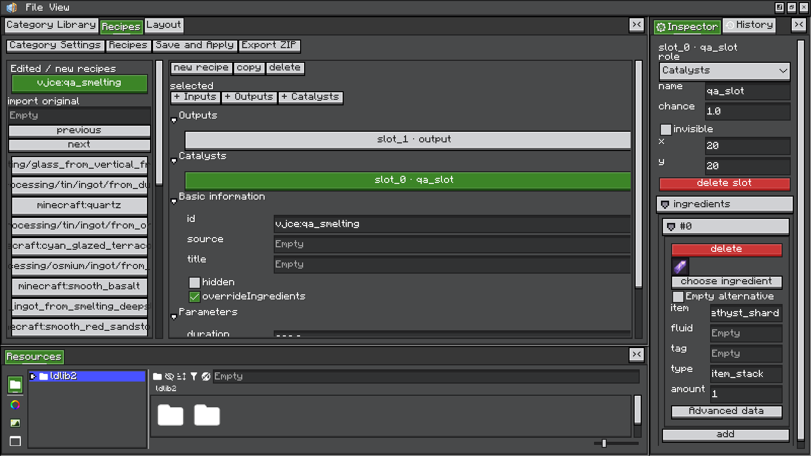
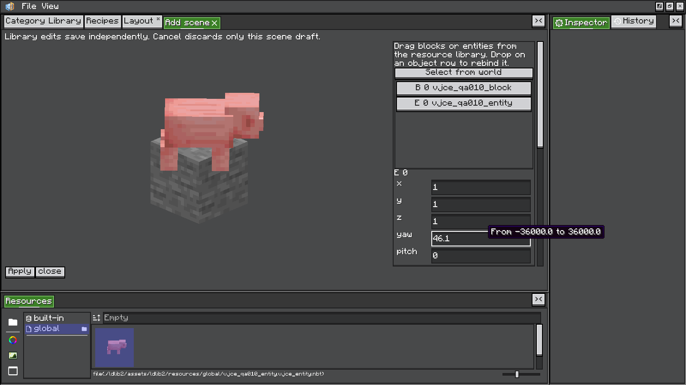
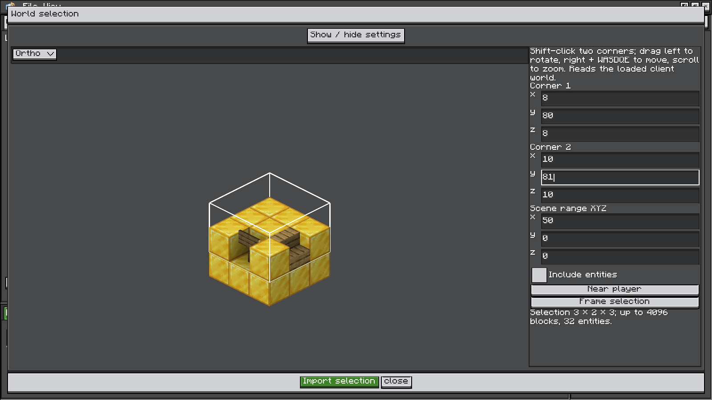

<div align="center">

# 进阶使用指南 / Advanced Guide

**从配方数据到三维场景，制作可分发的 JEI 展示页。**<br>
**Build shareable JEI pages, from recipe data to 3D scenes.**

Visual JEI Category Editor **1.0.0** · Minecraft **1.21.1** · NeoForge

[简体中文](#简体中文) · [English](#english) ·
[首页 / README](../README.md) · [示例 / Examples](../examples/) · [许可证 / License](../LICENSE)

</div>

## 简体中文

> [!IMPORTANT]
> VJCE 修改的是**客户端 JEI 展示**。实际合成、机器处理和服务端配方仍由原模组或配方脚本决定。
> 服务器无需安装 VJCE。

### 目录

1. [安装与兼容范围](#安装与兼容范围)
2. [制作流程与保存方式](#制作流程与保存方式)
3. [配方数据页](#配方数据页)
4. [画布与布局编辑](#画布与布局编辑)
5. [JEI 页面覆盖](#jei-页面覆盖)
6. [资源库与场景编辑](#资源库与场景编辑)
7. [从世界框选场景](#从世界框选场景)
8. [实体与动画](#实体与动画)
9. [控件绑定与表达式](#控件绑定与表达式)
10. [文件格式与导出](#文件格式与导出)
11. [常见问题](#常见问题)
12. [构建与验证](#构建与验证)

---

### 安装与兼容范围

使用 **Minecraft 1.21.1 + Java 21 + NeoForge**，将模组 JAR、LDLib2 和 JEI
放入客户端实例的 `mods/`。源码 JAR 不用于安装。

| 依赖 | VJCE 最低声明，无上限 | 开发／验收版本 |
| --- | --- | --- |
| NeoForge | `21.1.216+` | `21.1.248`、`21.1.262` |
| LDLib2 | `2.2.44+` | `2.2.44`，NeoForge 1.21.1 **all** 发行包 |
| JEI | `19.64.0.455+` | `19.70.0.464` |
| Mekanism，可选 | 由所选发行包决定 | `1.21.1-10.7.19.85` |
| Create，可选 | 由所选发行包决定 | `6.0.11-320`，Minecraft 1.21.1 |

**普通场景无需 Create。** 方块、实体、原生方块实体渲染和世界快照可独立使用。
只有 Create 压机、搅拌器、粉碎轮预设需要 Create，并沿用其 Ponder、Flywheel、Registrate 等前置。
MBD2 是编辑器交互的参考项目，无需安装。

#### 依赖元数据说明

运行依赖放宽后，编译依赖仍固定为原开发版本。JEI 19.64 的 API 引用和关键 Mixin 签名已静态核对，
尚未新增旧版组合的实机验收；取消上限也不表示所有后续版本均已验证兼容。

| 情况 | 安装时需要注意 |
| --- | --- |
| 依赖自身有更高要求 | 需同时满足。JEI `19.64.0.455` 自身要求 NeoForge `21.1.238+`。 |
| JEI 19.64 的 Minecraft 声明 | 已检查的官方 NeoForge Maven 制品声明 `[1.21,1.21.1)`，与本项目目标 1.21.1 冲突，加载器可能拒绝此组合；上游 SHA-1 与本机制品一致。 |
| LDLib2 下限 | 当前使用的 `getContentHost()` 和 `addFrameCallback()` 在 2.2.44 才提供，因此仅放宽声明时保留 `2.2.44` 下限。 |

VJCE 不修改第三方 JAR。选择发行包时应核对其 Minecraft 和 NeoForge 元数据；
**API 静态兼容不等于该制品已经通过安装或启动验证。**

### 制作流程与保存方式

1. **进入编辑器**：进入世界，在聊天栏执行 `/vjce editor`。
2. **选择分类**：在“分类库”中新建分类，或搜索已有 JEI 分类并创建覆盖工程。
   搜索支持名称、分类 ID、来源分类 ID、模组名称或 ID；自建分类会打开对应工程。
3. **配置分类**：设置资源 ID、标题、图标物品、页面宽高、催化物、自定义字段和表达式绑定。
4. **编辑配方**：在“配方数据”中读取来源配方；自建分类和已适配的原版分类可新增、复制配方。
   点击槽位，通过右侧检视面板设置候选原料、数量、概率与角色。
5. **安排布局**：在“页面布局”中调整组件位置、尺寸、背景、文字和样式。
   输入输出槽变化后，可使用“按数据重新生成布局”。
6. **预览**：点击播放按钮检查当前配方，停止后继续编辑。
7. **保存并应用**：写入运行配置，退出并重新进入世界，让 JEI 使用新配置。
8. **保留与分享**：`File → Save` 保存 `.vjce` 工程，使用“导出整合包 ZIP”或 `/vjce export` 分发。

#### 三种保存操作

| 操作 | 保存什么 | 何时使用 |
| --- | --- | --- |
| **保存并应用** | 分类与展示配方的运行配置 | 让 JEI 读取编辑结果；需重新进入世界 |
| **File → Save** | 可再次打开的 `.vjce` 工程 | 继续设计和维护工程 |
| **导出整合包 ZIP** | 运行配置、已保存工程及外部资源 | 迁移到其他实例或发布整合包 |

工程页签与独立窗口标题会显示分类名称和类型 ID，例如 `熔炼 [minecraft:smelting] *`。
`*` 表示未保存，修改名称后标题同步更新。

### 配方数据页

#### 浏览与槽位检视

| 区域 | 内容与操作 |
| --- | --- |
| 左侧浏览栏 | 浏览已编辑、新增和来源配方；切换配方保留来源搜索及浏览位置。 |
| 中间表单 | 独立滚动的槽位列表、基本信息和参数；槽位按输入、输出、催化、仅展示分组。 |
| 右侧 Inspector | 所选槽位的属性和可折叠候选原料；高级 codec 数据可在结构化标签编辑器中修改。 |

点击槽位后，槽位按钮显示绿色；删除按钮使用红色。新增槽位自动选中。
切换配方、离开配方数据页或打开资源检视时，槽位选择清空。
`empty` 显示为“空候选项”，用于保留来源配方的焦点关联。

左栏与中栏的分隔条可拖动，默认比例为 **25%**，会按可用空间限制两侧最小宽度。
比例全局保存在 `config/vjce/editor.json`，切页和重开工程后保留；分类设置页暂时占满配方数据区域。



#### 选择 JEI 原料

点击“选择 JEI 原料”打开弹窗，或直接从 JEI 拖入原料：

1. 在顶部选择已注册的原料类型。
2. 按名称或资源 ID 搜索。
3. 在缩略图网格中单击原料，弹窗关闭并返回槽位设置。

网格显示短名称，悬浮时显示完整名称与 ID；支持物品、流体、Mekanism 化学品及其他已注册 JEI 原料。
网格按行虚拟化，宽度变化后自动重排。复杂原料保留完整 codec 数据和独立数量，
Mekanism 化学物质另有数量适配，避免标准化编码丢失数量。

### 画布与布局编辑

#### 选择、变换与吸附

编辑态左键选中组件整体，并同步层级树、属性面板与选框；单击配方背景可选择背景。
点击完全空白处取消选择，拖动空白处平移画布。缩放和平移后按实际显示位置命中。

| 操作 | 行为 |
| --- | --- |
| `Alt` + 单击 | 循环选择重叠组件和整页原生图层 |
| `Shift` + 左键拖动 | 选中并移动组件；根画布固定 |
| `Ctrl` + 单击 | 进入绿色变换框模式，松开 `Ctrl` 后保持 |
| 拖绿色框上下边／左右边 | 分别修改高度／宽度，固定对边 |
| 拖绿色框四角 | 自由调整尺寸，固定对角 |
| `Ctrl` + 拖绿色框四角 | 等比例拉伸 |
| 绿色模式中 `Alt` + 左键拖动内部 | 绕中心旋转；同时按 `Shift` 时以 15° 吸附 |
| 移动或拉伸开始后按住 `Alt` | 暂停位置吸附；手势持续到松开鼠标 |
| 点击其他区域 | 退出绿色模式；点击其他组件时同时选择它 |
| `Esc` | 取消当前拖动；未拖动时退出绿色模式 |

移动与拉伸会对齐同父级可见元素及页面的四边、中心，显示 **1 个物理像素**粗的紫色参考线。
吸附阈值约为屏幕 **6 像素**，随 GUI 缩放换算。旋转后的框沿元素方向显示，
拉伸沿元素自身方向，对齐使用旋转后的水平包围矩形。

一次拖动对应一次撤销。撤销会恢复原来的百分比、自动布局及约束；操作后的坐标和尺寸保存为绝对像素。
切换工程、重新生成、开始预览或打开模态弹窗时，未完成的拖动会取消。
保存弹窗中的保存、不保存、取消及 `Esc` 优先由弹窗处理。

#### 尺寸、交互与外观

| 项目 | 规则 |
| --- | --- |
| 普通元素 | 最小 `1 × 1`，不翻转；允许超出页面 |
| 根画布 | 尺寸范围 `18～2048`，同步 JEI 页面宽高，不能旋转 |
| 页面外的交互 | 仍受 JEI 分类宽高限制 |
| 普通背景 | 独立变换，不带动兄弟元素 |
| 原生槽位、文字、装饰和整页图层 | 缩放、旋转同时用于实际 JEI 绘制与命中；槽位提示和焦点继续使用来源槽位 |

编辑器外框、菜单、分类界面及属性面板使用暗色外观；编辑工具输入框使用 **ui-ore**。
**ui-mc** 是 JEI 配方内容区及新增组件的默认材质；导入分类的专用背景、箭头和火焰保留原图形。
外观独立保存在 `config/vjce/editor.json`。升级时会一次性纠正旧的编辑器 MC 默认外观，并保留其他设置。
播放预览时保留页面交互。

### JEI 页面覆盖

#### 来源分类与适配范围

分类库包含全部已注册分类。覆盖工程 ID 包含来源命名空间，避免不同模组的同名路径冲突。
读取沿用原 `RecipeType`、实际配方对象和分类入口；动态配方继续由原 JEI 查询提供。

| 分类 | 支持情况 |
| --- | --- |
| 原版 12 类 | 工作台、切石、熔炉、烟熏炉、高炉、营火、锻造台、酿造、铁砧、砂轮、燃料、堆肥 |
| Mekanism | 已验收 30 个机器分类，每类至少一个实际页面样本 |
| 第三方特殊配方 | 布局与已有展示原料可按解析能力编辑；特殊字段、新增与复制仍需具体适配 |
| 空分类 | 提示没有可用样本 |
| 无稳定配方 ID | 允许分类级布局编辑，限制单条配方数据覆盖 |
| 无法安全解析的页面 | 保留实际原页并显示只读提示，不保存伪造布局 |

#### 原生绘制片段

打开来源分类时解析 JEI 创建的实际页面。槽位沿用原背景、渲染器、悬浮提示和焦点关联；
标准文字、箭头、火焰可成为独立元素，动画仍在原配方上下文中逐帧执行。
保存后的布局会补充其他配方特有的槽位或文字，并保留明确删除的状态。

| 元素 | 保留或解析的内容 |
| --- | --- |
| `native_layer` | 原分类背景及自定义绘制 |
| `native_overlay` | 来源自定义控件与装饰绘制入口 |
| `jei_text_…`、`jei_drawable_…` | 标准 JEI 文字与 Drawable |
| `draw_…` | 首次绘制后识别的常见纹理、填色、渐变、文字及物品绘制；含自定义 Widget 的普通 2D 绘制 |

Mekanism 的能量条、进度条、箭头和槽位装饰按完整 GuiElement 拆分，保留嵌套父子关系；
变换用于绘制、提示与已适配输入。Create 压机、搅拌器、粉碎轮可读取为完整原生动画元素，
普通阴影和箭头使用通用 2D 路径。

可分别移动、拉伸、旋转、隐藏元素，或关闭“保留原生绘制”。层级树多选同父级元素后，
可用“组合元素”建立真实父级，支持撤销与工程保存。文字可替换内容和颜色；
“替换原生纹理”接受资源位置，替换图需保持相应图集尺寸与 UV 布局。
原版烹饪耗时、经验、燃料时间、堆肥概率和砂轮经验已有数据适配。

自定义提示、点击和滚轮仍依赖组件适配。动态条件或循环导致身份无法可靠匹配时，保留原始显示并提示限制。
直接 GPU 绘制及未适配的三维渲染可能保留为整体原生图层，无法保证任意模组的内部绘制都能逐项编辑。

#### 展示覆盖与配方填充

| 操作 | 结果 |
| --- | --- |
| 仅修改布局 | 保留来源槽位名称、角色、候选原料、焦点关联及原填充逻辑 |
| 开启“覆盖展示原料” | 禁用该配方填充按钮，并提示原因 |
| 追加展示配方 | 默认禁用配方填充 |
| 删除来源配方的覆盖记录 | 恢复原配方显示 |
| 勾选“隐藏此配方” | 隐藏来源配方 |

来源配方通过 `source` 匹配原展示 ID。删除覆盖记录与隐藏原配方是两种不同操作。

### 资源库与场景编辑

#### 新建、编辑与应用

1. 在“页面布局”中点击“添加场景”，打开空白的可停靠编辑页。
2. 从下方资源管理器的“方块资源”或“实体资源”中，选择可写的 `global` 库。
3. 新增资源，双击后在 Inspector 设置类型与 NBT，再拖入中央三维预览。
4. 在右侧对象列表选择实例，调整坐标、`yaw/pitch/roll`、比例和实体姿态。
5. 点击“应用”校验并创建／更新场景；双击已有场景或右键“场景设置”可重新编辑。



| 投放位置 | 行为 |
| --- | --- |
| 已有方块表面 | 新方块放在相邻面；实体落在表面，保留小数坐标 |
| 三维预览空白处 | 方块投放到 `Y=0` 平面 |
| 对象列表空白处 | 添加实例并自动排列 |
| 已有对象行 | 重新绑定同类型资源 |

关闭编辑页会丢弃当前实例工作副本；新增和编辑场景支持布局撤销重做。

#### 共享资源与独立实例

资源库支持新增、配置、改名、复制、删除和拖出。**资源定义**保存类型、BlockState、NBT 和客户端更新标签；
**场景实例**保存资源引用以及独立的位置、旋转和缩放。资源改动会更新编辑器、预览和已缓存 JEI 页面。

编辑器内改名后引用自动续接。删除资源时保留实例和变换，并显示缺失占位；
恢复同路径资源或拖入新资源重新绑定即可恢复。资源定义、文件和改名索引随整合包导出。

> [!NOTE]
> 全局资源库独立保存。**取消场景只丢弃实例草稿，不撤销期间对全局资源的修改。**

在“方块资源 → global”中右键“添加新资源”，可创建默认方块、从 JEI 搜索方块物品，
或从当前玩家主背包与快捷栏选取。导入会读取物品的方块状态、方块实体 NBT 及其支持的物品组件，
例如潜影盒内容。资源名取自方块 ID，重名自动追加编号；机器实时状态通过世界框选采集。

#### 参数与数据结构

| 参数 | 范围或行为 |
| --- | --- |
| 对象数量 | 每场景最多 4096 个方块、32 个实体，至少一个对象 |
| 坐标 | `-64～64`；方块位置不能重复 |
| 实体比例 | `0.05～16` |
| 实体默认朝向 | 缩略图为正面斜 45°；拖入时根据当前视角计算并保存一次朝向 |
| 数值滚轮 | 先点击聚焦；整数步长 1，小数步长 0.1，`Shift` 加速 10 倍 |
| 取景与运动 | 自动取景、视角、视野范围、循环运动、速度、周期、相位、平移幅度 |

世界框选的独立快照可在“高级场景数据”中展开。方块包含 `x/y/z`、`state` 和 `data`；
实体包含 `id`、`x/y/z`、`yaw/pitch`、`scale`、`pose` 和 `data`。例如：

```snbt
{
  blocks: [
    {x: 0, y: -1, z: 0, state: {Name: "minecraft:gold_block"}}
  ],
  entities: [
    {
      id: "minecraft:zombie",
      x: 0d, y: 0d, z: 0d,
      yaw: 25f, pitch: 0f,
      scale: 1f,
      pose: "STANDING",
      data: {
        HandItems: [{id: "minecraft:iron_sword", count: 1}, {}],
        ArmorItems: [{}, {}, {}, {id: "minecraft:diamond_helmet", count: 1}]
      }
    }
  ]
}
```

### 从世界框选场景

#### 框选与导入

1. 双击场景或右键“场景设置”，点击“从世界框选”。
2. `Shift` + 左键依次指定两个角点，形成包含两端方块的长方体；也可输入六个坐标。
3. 按需启用“同时导入实体”，检查选区与对象数量。
4. 点击“导入选区”返回场景编辑，再点击“应用”更新配方。



| 控制 | 行为 |
| --- | --- |
| 左键拖动／滚轮 | 旋转／缩放世界预览 |
| 右键 + `WASDQE` | 使用 LDLib2 相机导航 |
| “玩家附近” | 返回玩家附近预览 |
| “显示选区” | 按输入坐标重新取景 |
| XYZ 场景范围 | 每次打开默认半径 5，合法范围 `0～50`；默认每轴加载 11 格 |
| 角点坐标框 | 聚焦后滚轮 ±1，`Shift` + 滚轮 ±10；不带动画布缩放，Y 限制在世界高度内 |
| 分隔条／参数栏 | 可拖动分隔，参数栏可折叠为全宽预览，底部按钮固定 |

“场景范围”控制玩家周围的预览加载范围，调整后刷新并重新取景，**不会改变选区角点**。
最终导入内容始终由两个角点决定。

#### 快照内容与边界

导入将选区最小角归零到 `(0,0,0)`，略过空气并保留方块朝向，
同时保存客户端可得的方块实体持久化 NBT 和原生更新标签；所有方块创建后依次恢复状态。
这能保留已同步的 Mekanism 储罐液体和等级颜色。旧快照缺少客户端状态时，需重新框选补齐。

“同时导入实体”默认关闭。开启后，绿色框标出位置点位于选区内的非玩家实体；
导入保存坐标、方向、姿态、装备和变种。原版已知附着位置、睡眠位置会转换为场景坐标，
未知模组 NBT 不做猜测性坐标改写；骑乘关系不保留。

| 限制 | 行为 |
| --- | --- |
| 每轴最多 32 格；最多 4096 方块、32 实体 | 超限提示并保留原工作副本 |
| 未加载区块、空内容或读取失败 | 导入失败，原工作副本不变 |
| 服务端未同步的库存或机器内部数据 | 客户端无法取得 |
| 相机和动画设置 | 重新导入时保留 |
| 原世界退出或结构改变 | 已保存独立快照仍可显示 |

> [!WARNING]
> 重新导入会**替换方块和实体两个列表**。未勾选“同时导入实体”也会清空旧实体，
> 包括手动添加的实体；勾选但新选区没有实体时同样清空。取消或失败保留原工作副本，
> 场景仍需点击“应用”才写入配方。

### 实体与动画

#### 原生实体与方块实体

场景使用独立的 LDLib2 展示世界，不向真实世界生成实体。
重开工程或 JEI 页面时创建新的实体实例与 UUID。实体固定在设定坐标，关闭 AI、重力和物理移动，
由客户端 tick 和原生 EntityRenderer 显示待机动画。

物品、展示实体、船和具有可用渲染器的模组实体使用相同路径。
玩家／皮肤、骑乘关系、行走／攻击动作预设暂不支持。
缺失注册项、需要完整世界上下文或无法持续待机的实体会显示错误。

原生方块实体使用实际 BlockEntityRenderer，也可运行客户端 tick。
实体与方块实体动画分别开关；自动取景按内容估算范围，也可关闭后手动设置。
依赖完整机器逻辑的第三方动画不保证自动运行。

#### 播放、暂停与循环

| 操作 | 行为 |
| --- | --- |
| 新增场景 | 编辑态暂停 |
| 点击布局播放按钮 | 运行预览，实际 JEI 页面自动播放 |
| “暂停动画／继续动画” | 控制预览场景，实体暂停同时冻结原生 tick 和渲染插值 |
| “重置动画” | 重置预览场景动画 |
| 整体循环 | 绕场景中心旋转和上下平移 |
| `+Create` | 添加 `PRESS`、`MIXER`、`CRUSHING_WHEELS` 预设及其适用参数 |

Create 元素使用各自的本地动画时钟，暂停、重置和变速不重置其他 Create／Ponder 页面的时钟。
原生渲染器自行使用的其他时钟仍遵循来源模组逻辑。完整关键帧时间轴不在本版本范围内。

<details>
<summary><strong>渲染、光照与资源释放细节</strong></summary>

场景先渲染为离屏纹理，再应用页面变换；旋转不改变三维投影比例，裁剪按变换后的四角计算。
父级变换、画布缩放、撤销重做及保存后的 JEI 页面使用同一布局。

自建场景使用 Create 风格的双向展示光照及全亮模型渲染层，方块、方块实体和实体统一使用展示光，
无需安装 Create。静态方块模型缓存，方块实体、模组动态模型和透明模型保留实时绘制；
动态模型读取方块实体 ModelData，并按实际 tint index 着色。
来源分类与 `+Create` 预设沿用各自渲染，结束或失败时恢复调用方状态。

VJCE 尊重原生 `shouldRender`，隔离并记录单个方块实体渲染异常。
框选窗口提供提示与重试，这也保护配方场景，但不修改真实世界或其他 LDLib 编辑器。

移除页面时释放离屏纹理和展示世界；JEI 缓存页面空闲两秒后释放，再显示时重建。
渲染或动画失败显示占位，并恢复画面、裁剪及实体渲染上下文。

</details>

### 控件绑定与表达式

#### 控件 ID

LDLib2 属性面板中的控件 ID 决定绑定内容：

| 控件 ID | 内容 |
| --- | --- |
| `slot_0`、`slot_1`… | 当前配方槽位列表中的对应项 |
| `duration` | 耗时，自动显示秒数 |
| `progress` | 按耗时循环的进度动画 |
| `field_energy` | 自定义字段 `energy` 的数值与单位 |
| `bar_energy` | 字段数值除以字段显示上限 |
| `jei_text_…`、`jei_drawable_…` | 从实际 JEI 页面解析出的文字与装饰 |
| `native_layer`、`native_overlay` | 保留来源逻辑的原生绘制部分 |

自定义资源字段支持单位、图标引用、显示上限和颜色，可显示为文字或数值条。

#### 表达式与格式

可绑定 `text`、`progress`、`visible` 和 `color`，引用自定义字段、配方 `values`、
`duration`、`seconds`、`inputs`、`outputs`。

| 类型 | 支持内容 |
| --- | --- |
| 算术与比较 | `+ - * / %`、比较运算 |
| 条件 | `&&`、`\|\|`、`!`、三元表达式 |
| 函数 | `min`、`max`、`clamp`、`abs`、`floor`、`ceil`、`round`、`sqrt` |

```text
energy / duration
temperature >= 1000 ? 1 : 0
clamp(energy / 10000, 0, 1)
```

`text` 的 `format` 使用 Java 数值格式，例如 `%.1f FE/t`。
解析出的原生文字也支持 `text`、`color`、`visible` 绑定。
表达式仅访问当前配方字段，未知字段、无效语法与非有限结果会报告错误。

### 文件格式与导出

#### 配置与命名

`config/vjce/categories/*.json` 保存带版本号的分类、配方、字段与绑定。
复杂布局保存在 JSON 的 `layout` 字符串中，使用 LDLib2 `UITemplate.CODEC` 的 SNBT 表示，
保留 NBT 类型与样式；建议在编辑器内维护。

文件平放于 `categories/`，名称取自工程资源 ID；覆盖分类追加 `@原分类ID`。
Windows 不允许的 `:` 编为 `~`，`/` 编为 `+`，不建立子目录。

| 工程 | 文件名 |
| --- | --- |
| 新建 `vjce:demo/example` | `vjce~demo+example.json` |
| 覆盖 `minecraft:smelting` | `vjce~demo+example@minecraft~smelting.json` |

资源 ID 或覆盖目标变化后，本版本生成的文件名在保存时更新；仅改显示标题不改文件名。
过长 ID 保留前缀并附加哈希。旧文件不会自动重命名或迁移，显式保存仍使用原文件名；
同 ID、同覆盖目标或文件名冲突会报错，避免覆盖其他配置。不提供旧版本工程的通用迁移。

[示例配置](../examples/) 可复制到实例根目录。
普通物品可填写 `item` 和 `amount`，物品标签填写 `tag`，流体标签还需指定流体类别。
复杂原料由编辑器保存完整 codec 数据，以保留物品组件等内容。

#### 导出整合包

```mcfunction
/vjce export
```

也可点击“导出整合包 ZIP”。输出为 `exports/vjce-modpack.zip`，
解压到目标整合包的**实例根目录**。包含 `config/vjce/categories/`、已保存工程、
LDLib2 管理的外部贴图、场景资源与改名索引。目标实例需安装 VJCE、必需前置及资源引用的其他模组。

### 常见问题

| 现象 | 排查与处理 |
| --- | --- |
| 保存后 JEI 没变化 | 确认已“保存并应用”，然后退出并重新进入世界；`File → Save` 用于保存编辑工程。 |
| 无法新增或复制第三方配方 | 第三方对象构造尚未适配，按钮会禁用；已有页面可按解析能力编辑。 |
| 删除覆盖后原配方又出现 | 删除覆盖会恢复原页；需要隐藏时勾选“隐藏此配方”。 |
| 储罐快照没有液体 | 旧快照可能缺客户端更新标签，重新从世界框选；服务器未同步的数据无法补出。 |
| 删除资源后场景出现占位 | 实例与变换仍保留；恢复同路径资源，或拖入同类型新资源重新绑定。 |
| 重新框选后手动实体消失 | 导入会替换两个对象列表，关闭实体导入也会清空旧实体。 |
| 模组方块实体渲染报错 | 查看日志和窗口提示；可重试框选。依赖完整机器逻辑的第三方渲染或动画不保证运行。 |
| 升级或初始化发生物品组件错误 | `Item cannot be both damageable and stackable` 已有保护；替换旧 JAR 并保留 `config/vjce/`。无法解析的页面保留原显示，并记录分类、来源 ID 与错误。 |

### 构建与验证

#### 构建与启动

使用 **JDK 21** 和项目自带 Gradle Wrapper：

```powershell
# Windows
.\gradlew.bat build
.\gradlew.bat runClient
```

```bash
# Linux / macOS
sh ./gradlew build
sh ./gradlew runClient
```

模组 JAR 和源码 JAR 输出到 `build/libs/`。
`gradle.properties` 的 `mod_version` 决定构建版本，元数据位于
`src/main/resources/META-INF/neoforge.mods.toml`。

#### 游戏内 UI 验证

```powershell
# 基础依赖环境
.\gradlew.bat runClient -PuiTest

# 加入 Mekanism
.\gradlew.bat runClient -PuiTest -PwithMekanism=true '-Pneo_version=21.1.262'

# 加入 Mekanism 与 Create
.\gradlew.bat runClient -PuiTest -PwithMekanism=true -PwithCreate=true '-Pneo_version=21.1.262'

# 指定原生页面场景
.\gradlew.bat runClient -PuiTest=vjce_native
```

`-PuiTest` 使用 LDLib2 游戏内测试框架，在隔离世界运行 `vjce` 组客户端场景，
输出 `build/ui-test/report.json` 和截图。测试配方仅在开发 UI 测试中注册。

<details>
<summary><strong>验证覆盖范围</strong></summary>

| 范围 | 主要检查 |
| --- | --- |
| 画布与变换 | 真实鼠标／键盘的选择、平移、吸附、拉伸、旋转、取消、撤销重做；实际 JEI 命中与原生输入坐标 |
| 分类与原生页面 | 遍历已注册分类；12 类原版页面与导入页面并排对照；保存后槽位、提示、填充、主题和恢复 |
| 模态与分栏 | 保存／不保存／取消／关闭的输入优先级，拖动回滚；SplitView 最小宽度、切页、重开和全局比例 |
| 配方与原料 | 来源搜索、角色分组、绿色选中、红色删除；物品／流体／化学品选择及数量保真 |
| 原生绘制片段 | 自定义 Widget 拆分、组合、替换、删除与保存；Mekanism／Create 组件适配 |
| 场景与实体 | 方块状态、原生 tick／暂停、装备／姿态、独立世界与 UUID、保存重建、资源释放和本地 Create 时钟 |
| 旋转与裁剪 | 0°／30°／45°／90°／135°／180°，真实 Alt 手势、父级变换及资源释放 |
| 世界框选 | 告示牌、方块状态、带装备实体；真实取点、取消、独立快照和数量／区块边界 |
| 兼容保护 | 物品组件校验、原格式读取、空分类、只读页面、无稳定 ID、命名空间冲突和失败隔离 |

</details>

以下像素检查需要 Python 和 Pillow，结合测试生成的截图使用：

```powershell
python qa/check-scene-rotation.py
python qa/check-scene-lighting.py
python qa/check-scene-snapshot.py
```

在开发客户端执行 `/vjce verify` 可生成 `vjce-audit.json`，
全分类测试另输出 `vjce-category-audit.json`。安装 Create 时，光照测试还会与实际 GuiGameElement 比较。

#### 打包源码与示例

构建后执行：

```powershell
python qa/package-release.py
```

产物写入 `dist/`：模组 JAR、源码 JAR、可编辑项目 ZIP、示例配置 ZIP 和 SHA-256 清单。
项目 ZIP 中的 `docs/` 仅包含本指南与截图。

---

[返回目录](#目录) · [返回双语首页](../README.md)

---

## English

> [!IMPORTANT]
> VJCE edits **client-side JEI presentation**. Actual crafting, machine processing and server recipes
> remain controlled by the original mod or your recipe scripts. VJCE is not required on the server.

### Contents

1. [Installation and compatibility](#installation-and-compatibility)
2. [Workflow and saving](#workflow-and-saving)
3. [Recipe data](#recipe-data)
4. [Canvas and layout editing](#canvas-and-layout-editing)
5. [JEI page overrides](#jei-page-overrides)
6. [Resource library and scene editing](#resource-library-and-scene-editing)
7. [Capturing scenes from the world](#capturing-scenes-from-the-world)
8. [Entities and animation](#entities-and-animation)
9. [Control bindings and expressions](#control-bindings-and-expressions)
10. [File formats and export](#file-formats-and-export)
11. [Troubleshooting](#troubleshooting)
12. [Building and validation](#building-and-validation)

---

### Installation and compatibility

Use **Minecraft 1.21.1, Java 21 and NeoForge**. Put the mod JAR, LDLib2 and JEI
in the client's `mods/` folder. Do not install the sources JAR.

| Dependency | VJCE minimum, with no upper bound | Development / validation versions |
| --- | --- | --- |
| NeoForge | `21.1.216+` | `21.1.248`, `21.1.262` |
| LDLib2 | `2.2.44+` | `2.2.44`, NeoForge 1.21.1 **all** distribution |
| JEI | `19.64.0.455+` | `19.70.0.464` |
| Mekanism, optional | Determined by the selected release | `1.21.1-10.7.19.85` |
| Create, optional | Determined by the selected release | `6.0.11-320`, Minecraft 1.21.1 |

**Ordinary scenes work without Create.** Blocks, entities, native block entity rendering and world
snapshots are available independently. Only the Create press, mixer and crushing wheel presets
require Create and its dependencies, including Ponder, Flywheel and Registrate.
MBD2 inspired the editor workflow and is not a dependency.

#### Dependency metadata notes

Runtime requirements have been relaxed; compile dependencies remain pinned to the original
development versions. JEI 19.64 API references and key Mixin signatures have been checked statically.
The older combinations have not received new in-game validation, and removing upper bounds
does not verify compatibility with every later release.

| Situation | Installation consideration |
| --- | --- |
| A dependency requires a higher version | Its requirements still apply. JEI `19.64.0.455` itself requires NeoForge `21.1.238+`. |
| JEI 19.64 Minecraft metadata | The inspected official NeoForge Maven artifact declares `[1.21,1.21.1)`, conflicting with this project's 1.21.1 target. The loader may reject this combination; the upstream SHA-1 matches the local artifact. |
| LDLib2 minimum | The editor uses `getContentHost()` and `addFrameCallback()`, introduced in 2.2.44. Keeping the existing implementation requires a `2.2.44` minimum. |

VJCE does not modify third-party JARs. Check a release's Minecraft and NeoForge metadata before
installing it. **Static API compatibility does not mean that the artifact has passed installation
or startup validation.**

### Workflow and saving

1. **Open the editor:** enter a world and run `/vjce editor` in chat.
2. **Choose a category:** create one in **Category Library**, or find an existing JEI category
   and create an override project. Search supports names, category IDs, source category IDs,
   and mod names or IDs. Selecting a VJCE category opens its project.
3. **Configure the category:** set its resource ID, title, icon item, page dimensions, catalysts,
   custom fields and expression bindings.
4. **Edit recipes:** read source recipes in **Recipes**. Custom categories and adapted vanilla
   categories support creating and copying recipes. Select a slot and use the right-hand
   inspector to edit ingredient alternatives, amounts, chances and roles.
5. **Arrange the layout:** open **Layout** to change positions, sizes, backgrounds, text and styles.
   Use **Generate Layout** after changing input or output slots when a new layout is needed.
6. **Preview:** use the play button to check the current recipe; stop playback to continue editing.
7. **Save and Apply:** write the runtime configuration, then leave and re-enter the world
   for JEI to use it.
8. **Keep and share:** use `File → Save` for an editable `.vjce` project, and **Export ZIP**
   or `/vjce export` for distribution.

#### Three ways to save

| Action | What it saves | When to use it |
| --- | --- | --- |
| **Save and Apply** | Category and display recipe runtime configuration | Apply changes to JEI after re-entering the world |
| **File → Save** | An editable `.vjce` project | Continue designing and maintaining the project |
| **Export ZIP** | Runtime configurations, saved projects and external resources | Move to another instance or distribute a modpack |

Project tabs and detached window titles show the category name and type ID, for example
`Smelting [minecraft:smelting] *`. The `*` indicates unsaved changes; renaming updates the title.

### Recipe data

#### Browsing and inspecting slots

| Area | Content and controls |
| --- | --- |
| Left browser | Edited, new and source recipes. Switching recipes preserves the source search and browsing position. |
| Middle form | Independently scrolling slots, basic information and parameters. Slots are grouped as inputs, outputs, catalysts and display only. |
| Right-hand Inspector | Selected slot properties and collapsible ingredient alternatives. Advanced codec data uses a structured tag editor. |

Selected slot buttons turn green; delete buttons are red. New slots are selected automatically.
Switching recipes, leaving the recipe data tab or inspecting a resource clears the slot selection.
An `empty` entry appears as **Empty alternative** and preserves source recipe focus links.

Drag the divider between the left browser and middle form to resize them. The default ratio is
**25%**, with minimum widths adjusted to the available space. The ratio is saved globally in
`config/vjce/editor.json` and survives tab changes and reopening projects. Category settings
temporarily occupy the entire recipe data area.


#### Choosing JEI ingredients

Use **choose ingredient** to open the picker, or drag ingredients directly from JEI:

1. Select a registered ingredient type at the top.
2. Search by name or resource ID.
3. Click an ingredient in the thumbnail grid. The picker closes and returns to slot settings.

The grid shows short names, with full names and IDs on hover. It supports items, fluids,
Mekanism chemicals and other registered JEI ingredient types. Rows are virtualized and reflow
when the available width changes. Complex ingredients retain their full codec data and a separate
amount; an additional Mekanism adapter preserves quantities lost during standard normalization.

### Canvas and layout editing

#### Selection, transforms and snapping

In edit mode, left-click selects an entire element and synchronizes the hierarchy, inspector and
selection frame. Click the recipe background to select it. Clicking completely empty space clears
the selection; dragging that space pans the canvas. Hit testing follows the displayed positions
after zooming or panning.

| Action | Result |
| --- | --- |
| `Alt` + click | Cycle through overlapping elements and full-page native layers |
| `Shift` + left-drag | Select and move an element; the root canvas stays fixed |
| `Ctrl` + click | Enter green transform mode, which remains active after releasing `Ctrl` |
| Drag a green top/bottom or left/right edge | Change height or width while keeping the opposite edge fixed |
| Drag a green corner | Resize freely while keeping the opposite corner fixed |
| `Ctrl` + drag a green corner | Resize proportionally |
| `Alt` + left-drag inside the green frame | Rotate around the center; add `Shift` for 15° snapping |
| Hold `Alt` after starting a move or resize | Disable alignment snapping; the gesture continues until mouse release |
| Click elsewhere | Leave transform mode; clicking another element also selects it |
| `Esc` | Cancel the current drag, or leave transform mode when idle |

Moving and resizing align to the edges and centers of the page and visible siblings. Purple guides
are **one physical pixel** wide. The snapping threshold is approximately **six screen pixels**,
adjusted for GUI scale. A rotated frame follows the element's orientation; resizing uses its local
axes, while alignment uses its rotated axis-aligned bounding rectangle.

Each drag creates one undo operation. Undo restores the original percentages, automatic layout
and constraints; the completed operation stores position and size as absolute pixels.
Switching projects, regenerating the layout, starting preview or opening a modal cancels an
unfinished drag. Save dialogs take priority for Save, Don't Save, Cancel and `Esc` input.

#### Dimensions, interaction and appearance

| Item | Rule |
| --- | --- |
| Ordinary elements | Minimum `1 × 1`; no flipping; may extend beyond the page |
| Root canvas | Dimensions `18–2048`, synchronized with the JEI page size; cannot rotate |
| Interaction outside the page | Still limited by the JEI category dimensions |
| Ordinary background | Transforms independently without moving siblings |
| Native slots, text, decoration and full-page layers | Scaling and rotation affect actual JEI drawing and hit testing; tooltips and focus queries still use the source slots |

The editor frame, menus, category forms and inspector use a dark theme. Editor input fields use
**ui-ore**. **ui-mc** is the default for JEI recipe content and newly added controls; imported
backgrounds, arrows and flames keep their original appearance. Appearance settings are stored
separately in `config/vjce/editor.json`. A one-time upgrade correction fixes the old editor MC
default while retaining other settings. Page interaction remains available during preview.

### JEI page overrides

#### Source categories and adapters

The library includes every registered category. Override project IDs include the source namespace
to avoid collisions between mods with identical paths. Reading preserves the original `RecipeType`,
actual recipe objects and category entry; dynamic recipes continue to come from original JEI queries.

| Category | Support |
| --- | --- |
| 12 vanilla categories | Crafting, stonecutting, smelting, smoking, blasting, campfire cooking, smithing, brewing, anvil, grindstone, fuel and composting |
| Mekanism | 30 machine categories have recorded validation, with at least one actual page sample each |
| Special third-party recipes | Layout and existing display ingredients are editable where parsing allows; special fields, creation and copying require specific adapters |
| Empty categories | Report that no sample is available |
| Recipes without stable IDs | Allow category-level layout editing while restricting individual recipe data overrides |
| Pages that cannot be safely parsed | Keep the actual original page read-only; no fabricated editable layout is saved |

#### Native drawing fragments

Opening a source category parses the actual page created by JEI. Slots retain their backgrounds,
renderers, tooltips and focus links. Standard text, arrows and flames can become independent
elements; animations still run every frame in the original recipe context. Saved layouts add
slots or text unique to other recipes while preserving explicitly deleted element states.

| Element | Content retained or parsed |
| --- | --- |
| `native_layer` | Original category background and custom drawing |
| `native_overlay` | Source custom widgets and decoration drawing entry points |
| `jei_text_…`, `jei_drawable_…` | Standard JEI text and drawables |
| `draw_…` | Common textures, fills, gradients, text and item drawing identified after the first draw, including ordinary 2D drawing from custom widgets |

Mekanism energy bars, progress bars, arrows and slot decorations are split by complete GuiElement,
preserving nested parent-child relationships. Transforms affect drawing, tooltips and adapted input.
Create press, mixer and crushing wheel animations can be read as complete native animation
elements; ordinary shadows and arrows use the generic 2D path.

Move, resize, rotate or hide elements individually, or turn off **Keep source drawing**.
Select sibling elements in the hierarchy and use **Group elements** to create a real parent,
with undo and project persistence. Text content and color can be replaced. **Replace native texture**
accepts a resource location; replacement images must match the original atlas dimensions and UV
layout. Vanilla cooking duration, experience, fuel time, compost chance and grindstone experience
have data adapters.

Custom tooltips, clicks and scrolling still require component adapters. If dynamic conditions or
loops prevent reliable drawing identity matching, the original display is retained with a limitation
message. Direct GPU drawing and unadapted 3D rendering may remain as whole native layers;
not every mod's internal drawing can be edited element by element.

#### Display overrides and recipe transfer

| Action | Result |
| --- | --- |
| Change only the layout | Preserve source slot names, roles, alternatives, focus links and original recipe transfer logic |
| Enable `overrideIngredients` | Disable transfer for that recipe and explain why |
| Add a display recipe | Disable recipe transfer by default |
| Delete a source recipe's override record | Restore the original recipe display |
| Enable `hidden` for the recipe | Hide the source recipe |

Source recipes are matched by their original display ID through `source`.
Deleting an override and hiding the original recipe are separate operations.

### Resource library and scene editing

#### Creating, editing and applying

1. In **Layout**, select **Add scene** to open an empty dockable scene tab.
2. In the lower resource browser, select **Block resources** or **Entity resources**
   and choose the writable `global` library.
3. Add a resource, double-click it to configure its type and NBT in the Inspector,
   then drag it into the central 3D preview.
4. Select an instance in the right-hand object list to edit position, `yaw/pitch/roll`,
   scale and entity pose.
5. Select **Apply** to validate and create or update the scene. Double-click an existing scene
   or use **Scene settings** in its context menu to reopen it.


| Drop target | Result |
| --- | --- |
| Existing block surface | A new block is placed on the adjacent face; an entity lands on the surface with fractional coordinates |
| Empty space in the 3D preview | Blocks are placed on the `Y=0` plane |
| Empty space in the object list | Add an instance and arrange it automatically |
| Existing object row | Rebind to a resource of the same type |

Closing the scene tab discards the current instance draft. Creating and editing scenes supports
layout undo/redo.

#### Shared resources and independent instances

The library supports creating, configuring, renaming, copying, deleting and dragging resources.
A **resource definition** stores its type, BlockState, NBT and client update tag. A **scene instance**
stores the reference and its own position, rotation and scale. Resource changes update the editor,
preview and cached JEI pages.

Renaming in the editor keeps references connected. Deleting a resource preserves instances and
transforms, showing a missing-resource placeholder. Restore the resource at the same path or drag
in another resource to rebind it. Resource definitions, files and rename indexes are exported
with the modpack.

> [!NOTE]
> The global library saves independently. **Canceling a scene discards its instance draft,
> but does not undo changes to the shared resource library.**

In **Block resources → global**, use the context menu to add a default block, search JEI for
block items, or choose from the player's main inventory and hotbar. Import reads block state,
block entity NBT and supported item components, such as shulker box contents. Names come from
the block ID, with a numeric suffix for duplicates. Capture live machine state through world selection.

#### Parameters and data structure

| Parameter | Range or behavior |
| --- | --- |
| Object count | Up to 4096 blocks and 32 entities per scene; at least one object |
| Coordinates | `-64–64`; block positions cannot overlap |
| Entity scale | `0.05–16` |
| Initial entity orientation | Thumbnails show a 45° front view; dragging calculates and saves orientation once from the current camera |
| Numeric scrolling | Click to focus first; integer steps of 1, decimal steps of 0.1, `Shift` multiplies the step by 10 |
| Framing and movement | Automatic framing, camera angles, view range, loop motion, speed, period, phase and translation amplitude |

Expand **Advanced scene data** for an independent world snapshot. Block entries contain `x/y/z`,
`state` and `data`; entity entries contain `id`, `x/y/z`, `yaw/pitch`, `scale`, `pose` and `data`.
For example:

```snbt
{
  blocks: [
    {x: 0, y: -1, z: 0, state: {Name: "minecraft:gold_block"}}
  ],
  entities: [
    {
      id: "minecraft:zombie",
      x: 0d, y: 0d, z: 0d,
      yaw: 25f, pitch: 0f,
      scale: 1f,
      pose: "STANDING",
      data: {
        HandItems: [{id: "minecraft:iron_sword", count: 1}, {}],
        ArmorItems: [{}, {}, {}, {id: "minecraft:diamond_helmet", count: 1}]
      }
    }
  ]
}
```

### Capturing scenes from the world

#### Selecting and importing

1. Double-click a scene or open **Scene settings**, then choose **Select from world**.
2. `Shift` + left-click two corners to define a cuboid including both corner blocks,
   or enter the six coordinates directly.
3. Enable **Include entities** if needed, and check the selection and object count.
4. Select **Import selection** to return to the scene editor, then **Apply** to update the recipe.


| Control | Result |
| --- | --- |
| Left-drag / mouse wheel | Rotate / zoom the world preview |
| Right mouse button + `WASDQE` | Use LDLib2 camera navigation |
| **Near player** | Return to the preview around the player |
| **Frame selection** | Frame the entered coordinates |
| **Scene range XYZ** | Radius defaults to 5 each time the window opens; range `0–50`, with 11 blocks loaded per axis by default |
| Corner coordinate fields | Focus first; wheel changes by ±1, `Shift` + wheel by ±10, without zooming the canvas; Y is clamped to world height |
| Divider / settings panel | Drag to resize, or collapse the settings panel for a full-width preview; bottom buttons remain fixed |

**Scene range XYZ** controls how much of the world around the player is loaded into the preview.
Changing it refreshes and reframes the preview, but **does not change the selection corners**.
The two corners always determine the imported content.

#### Snapshot content and limits

Import moves the minimum selection corner to `(0,0,0)`, skips air and retains block orientation.
It saves the block entity persistent NBT and native update tags available to the client, restoring
them after all blocks are created. This preserves synchronized Mekanism tank contents and tier
colors. Older snapshots missing client state must be captured again.

**Include entities** is disabled by default. When enabled, green boxes mark non-player entities
whose position points lie inside the selection. Import stores position, orientation, pose, equipment
and variants. Known vanilla attachment and sleeping positions are converted to scene coordinates;
unknown mod NBT coordinates are not rewritten by guesswork. Riding relationships are not retained.

| Limit or condition | Behavior |
| --- | --- |
| Up to 32 blocks per axis; 4096 blocks and 32 entities | Exceeding limits reports an error and preserves the current draft |
| Unloaded chunks, empty content or read failures | Import fails without changing the draft |
| Inventories or machine internals not synchronized by the server | Unavailable to the client |
| Camera and animation settings | Preserved during re-import |
| Leaving the source world or changing its structure | Saved independent snapshots remain available |

> [!WARNING]
> Re-importing **replaces both the block and entity lists**. Disabling **Include entities** also
> clears existing entities, including manually placed ones. Enabling it when the new selection
> has no entities also clears the list. Canceling or failing preserves the draft; the scene
> is not written to the recipe until **Apply** is selected.

### Entities and animation

#### Native entities and block entities

Scenes use independent LDLib2 display worlds and do not spawn entities in the real world.
Reopening a project or JEI page creates fresh entity instances and UUIDs. Entities remain anchored
with AI, gravity and physical movement disabled; client ticks and the native EntityRenderer
provide idle animations.

Items, display entities, boats and modded entities with usable renderers follow the same path.
Players/skins, riding relationships and walk/attack presets are not supported. Missing registry
entries, entities requiring full world context or entities unable to idle continuously show errors.

Block entities use their actual BlockEntityRenderer and can run client ticks. Entity and block
entity animation have separate toggles. Automatic framing estimates the content bounds; disable
it to set framing manually. Third-party animation that depends on complete machine logic may not run.

#### Playback, pause and loops

| Action | Result |
| --- | --- |
| Add a scene | Starts paused in edit mode |
| Use the layout play button | Run preview; actual JEI pages play automatically |
| **Pause animation / Resume animation** | Control preview scenes; pausing entities freezes both native ticks and render interpolation |
| **Reset animation** | Reset preview scene animation |
| Loop motion | Rotate around the scene center or move up and down |
| `+Create` | Add `PRESS`, `MIXER` or `CRUSHING_WHEELS` with applicable parameters |

Each Create element has a local animation clock; pausing, resetting or changing speed does not reset
other Create/Ponder pages. Other clocks used internally by native renderers follow the source mod's
logic. A full keyframe timeline is outside the scope of this version.

<details>
<summary><strong>Rendering, lighting and resource cleanup</strong></summary>

Scenes render to an offscreen texture before page transforms are applied. Rotation does not distort
the 3D projection, and clipping follows the transformed corners. Parent transforms, canvas zoom,
undo/redo and saved JEI pages use the same layout.

Custom scenes use Create-style two-direction display lighting and full-bright model rendering for
blocks, block entities and entities, without requiring Create. Static block models are cached;
block entities, modded dynamic models and transparent models are drawn live. Dynamic models read
block entity ModelData and use each face's actual tint index. Source categories and `+Create`
presets retain their own rendering. Caller state is restored on completion or failure.

VJCE respects native `shouldRender` checks and isolates and logs individual block entity rendering
failures. The world selection window offers a message and retry. This also protects recipe scenes,
without changing the real world or other LDLib editors.

Removing a page releases its offscreen textures and display world. Cached JEI pages also release
them after two idle seconds and rebuild on display. Renderer or animation failures show a
placeholder and restore drawing, clipping and entity renderer context.

</details>

### Control bindings and expressions

#### Control IDs

The control ID in the LDLib2 inspector determines its binding:

| Control ID | Content |
| --- | --- |
| `slot_0`, `slot_1`… | Corresponding entry in the current recipe's slot list |
| `duration` | Duration, displayed automatically in seconds |
| `progress` | Progress animation looping over the duration |
| `field_energy` | Value and unit of the custom `energy` field |
| `bar_energy` | Field value divided by its display maximum |
| `jei_text_…`, `jei_drawable_…` | Text and decoration parsed from the actual JEI page |
| `native_layer`, `native_overlay` | Native drawing that retains source logic |

Custom resource fields support units, icon references, display maxima and colors,
and can appear as text or numeric bars.

#### Expressions and formatting

Bind `text`, `progress`, `visible` or `color`, referencing custom fields, recipe `values`,
`duration`, `seconds`, `inputs` and `outputs`.

| Type | Supported operations |
| --- | --- |
| Arithmetic and comparison | `+ - * / %` and comparison operators |
| Conditions | `&&`, `\|\|`, `!` and ternary expressions |
| Functions | `min`, `max`, `clamp`, `abs`, `floor`, `ceil`, `round`, `sqrt` |

```text
energy / duration
temperature >= 1000 ? 1 : 0
clamp(energy / 10000, 0, 1)
```

The `format` for a `text` binding uses Java numeric formatting, for example `%.1f FE/t`.
Parsed native text also supports `text`, `color` and `visible` bindings. Expressions only access
the current recipe's fields. Unknown fields, invalid syntax and non-finite results report errors.

### File formats and export

#### Configuration and naming

`config/vjce/categories/*.json` stores versioned category, recipe, field and binding data.
Complex layouts are stored in the JSON `layout` string as LDLib2 `UITemplate.CODEC` SNBT,
preserving NBT types and styles. Maintain layouts in the editor where possible.

Files stay directly inside `categories/`, named after the project resource ID. Overrides append
`@sourceCategoryID`. For Windows compatibility, `:` becomes `~` and `/` becomes `+`;
no subdirectories are created.

| Project | Filename |
| --- | --- |
| New `vjce:demo/example` | `vjce~demo+example.json` |
| Override of `minecraft:smelting` | `vjce~demo+example@minecraft~smelting.json` |

Changing the resource ID or override target updates filenames generated by this version on save;
changing only the display title does not. Long IDs retain a readable prefix plus a hash.
Old files are not renamed or migrated automatically and keep their old names on explicit save.
Duplicate IDs, targets or filenames report errors to avoid overwriting another configuration.
There is no general migration for older project versions.

Copy the [example configuration](../examples/) into the instance root.
Simple items can use `item` and `amount`; item tags use `tag`, and fluid tags also need their fluid
type specified. The editor saves full codec data for complex ingredients to retain item components.

#### Exporting a modpack

```mcfunction
/vjce export
```

Alternatively, select **Export ZIP**. Extract the output, `exports/vjce-modpack.zip`, into the target
modpack's **instance root**. It includes `config/vjce/categories/`, saved projects, external textures,
scene resources and rename indexes managed by LDLib2. The target instance needs VJCE, its required
dependencies and any other mods referenced by those resources.

### Troubleshooting

| Symptom | Check or solution |
| --- | --- |
| JEI does not change after saving | Use **Save and Apply**, then leave and re-enter the world. `File → Save` saves the editable project. |
| Cannot create or copy a third-party recipe | Constructing that recipe object needs an adapter, so the buttons are disabled. Existing pages remain editable where parsing allows. |
| The original recipe returns after deleting an override | Deleting an override restores the original page. Use `hidden` to hide it. |
| A tank snapshot has no fluid | Older snapshots may lack client update tags. Capture the world selection again; unsynchronized server data cannot be recovered. |
| A scene shows a placeholder after deleting a resource | Instances and transforms are retained. Restore the same resource path or drag in a new resource of the same type to rebind. |
| Manually added entities disappear after re-import | Import replaces both object lists, even with entity import disabled. |
| A modded block entity renderer fails | Read the log and window message; retry world selection. Rendering or animation requiring complete machine logic may not work. |
| Item component error during upgrade or initialization | Protection exists for `Item cannot be both damageable and stackable`. Replace the old JAR and retain `config/vjce/`. Unparseable pages keep their original display and log the category, source ID and error. |

### Building and validation

#### Build and launch

Use **JDK 21** and the included Gradle Wrapper:

```powershell
# Windows
.\gradlew.bat build
.\gradlew.bat runClient
```

```bash
# Linux / macOS
sh ./gradlew build
sh ./gradlew runClient
```

Mod and sources JARs are written to `build/libs/`. The build version comes from `mod_version`
in `gradle.properties`; mod metadata is in `src/main/resources/META-INF/neoforge.mods.toml`.

#### In-game UI validation

```powershell
# Required dependencies only
.\gradlew.bat runClient -PuiTest

# With Mekanism
.\gradlew.bat runClient -PuiTest -PwithMekanism=true '-Pneo_version=21.1.262'

# With Mekanism and Create
.\gradlew.bat runClient -PuiTest -PwithMekanism=true -PwithCreate=true '-Pneo_version=21.1.262'

# Select the native page scenario
.\gradlew.bat runClient -PuiTest=vjce_native
```

`-PuiTest` uses LDLib2's in-game test framework to run the `vjce` group in an isolated world,
writing `build/ui-test/report.json` and screenshots. Test recipes are registered only for
development UI tests.

<details>
<summary><strong>Validation coverage</strong></summary>

| Area | Main checks |
| --- | --- |
| Canvas and transforms | Real mouse/keyboard selection, panning, snapping, resizing, rotation, cancel and undo/redo; actual JEI hit testing and native input coordinates |
| Categories and native pages | Registered category traversal; side-by-side comparisons of 12 vanilla and imported pages; slots, tooltips, transfer, themes and restoration after saving |
| Modals and split panels | Input priority for Save/Don't Save/Cancel/Close, drag rollback; minimum widths, tab changes, reopening and global split ratios |
| Recipes and ingredients | Source search, role groups, green selection and red deletion; item/fluid/chemical selection and amount fidelity |
| Native drawing fragments | Custom widget splitting, grouping, replacement, deletion and persistence; Mekanism/Create adapters |
| Scenes and entities | Block state, native ticks/pause, equipment/pose, independent worlds and UUIDs, rebuilding from saved data, cleanup and local Create clocks |
| Rotation and clipping | 0°/30°/45°/90°/135°/180°, real Alt gestures, parent transforms and resource cleanup |
| World selection | Signs, block state and equipped entities; real corner picking, cancellation, independent snapshots and object/chunk limits |
| Compatibility protection | Item component validation, original format reading, empty categories, read-only pages, missing stable IDs, namespace collisions and failure isolation |

</details>

These pixel checks require Python and Pillow and use screenshots generated by the tests:

```powershell
python qa/check-scene-rotation.py
python qa/check-scene-lighting.py
python qa/check-scene-snapshot.py
```

Run `/vjce verify` in a development client to generate `vjce-audit.json`.
The full-category test also writes `vjce-category-audit.json`. With Create installed,
the lighting test compares against actual GuiGameElement rendering.

#### Packaging source and examples

After building, run:

```powershell
python qa/package-release.py
```

Outputs in `dist/` include the mod JAR, sources JAR, editable project ZIP, example configuration ZIP
and SHA-256 list. The project ZIP's `docs/` contains only this guide and the screenshots.

---

[Back to contents](#contents) · [Back to README](../README.md) · [简体中文](#简体中文)
