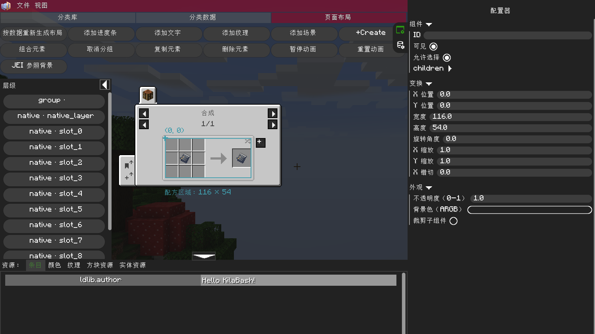
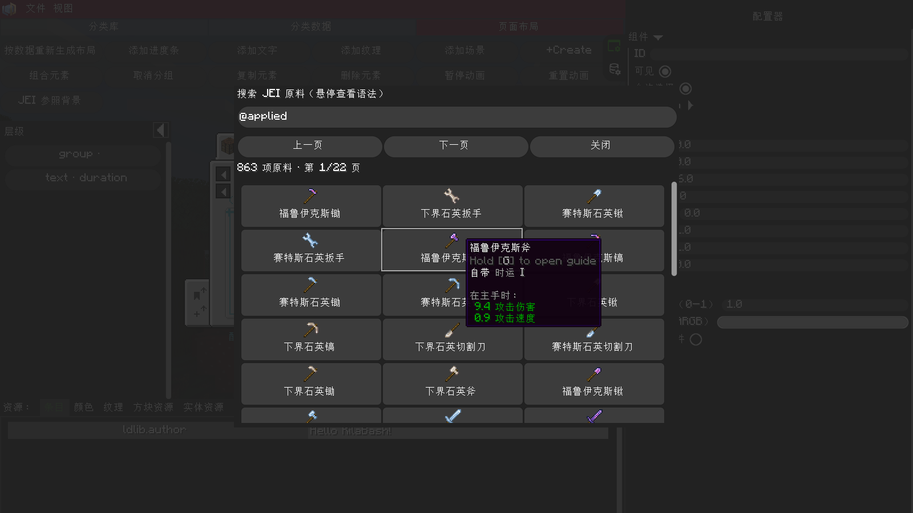
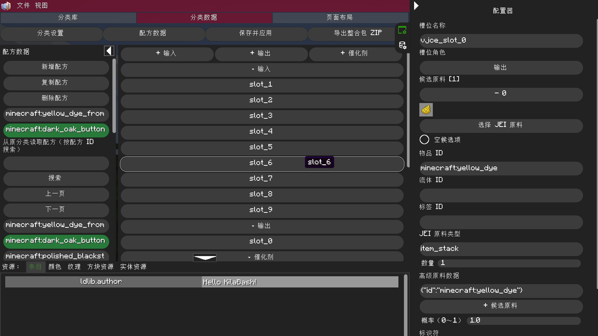
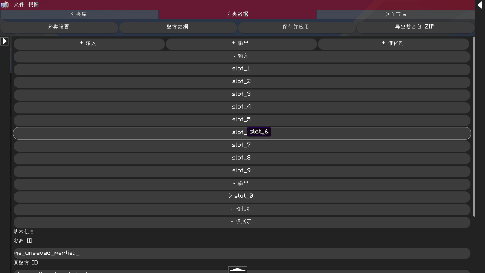
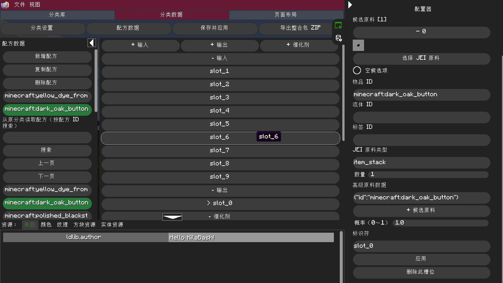

# Forge 1.20.1 使用指南

此分支使用 LDLib1，参考 MBD2 1.20.1 的编辑器、资源库与材质机制。依赖和构建命令见 [README](../README.md)。

## 保存与发布

“File → Save”保存完整 `.vjce1201` 工程，包含文档、当前配方与项目资源。“保存并应用”写入 `config/vjce-1.20.1/categories/` 的 JSON，重新进入世界后 JEI 读取这些配置。两者用途不同。项目格式标识为 `schemaVersion: 2`、`minecraftVersion: 1.20.1`、`layoutEngine: vjce-ldlib1`。

导出归档包含分类 JSON、已保存工程与 `ldlib/assets/`。外部 PNG 和材质资源应放在 LDLib 管理的资源目录，避免依赖本机其他路径。接收方仍需相同的原料与场景模组。

## 分类与原料

分类库可以按分类 ID、标题和模组名搜索。分类数据页可编辑分类标题、图标、尺寸、自定义字段及绑定。切换到配方模式选择、复制或删除展示配方；原生分类提供原配方搜索与导入。

槽位支持 INPUT、OUTPUT、CATALYST、RENDER_ONLY 四种角色。候选原料可以从选择器添加或拖放，保留物品 NBT、流体及已注册 JEI 原料的类型与数量。槽位标识将数据连接到画布；目标已被占用时会提示交换绑定。中栏的“+输入、+输出、+催化剂”按顺序同一行等宽排列，下方是四种角色的槽位树；右侧配置槽位角色、绑定、属性、原料候选和“删除此槽位”，通过外层唯一的纵向滚动条访问全部字段。删除数据槽位保留共享画布槽位；改动原料或槽位后自动清除旧焦点关联。当前配方在已导入列表和原分类列表中同步显示绿色背景。JEI 选择器显示原料图标、名称和悬浮提示。

原生分类只改变展示。修改原料会禁用该展示的配方填充，避免把展示配方当作实际合成。无法安全解析的控件保留原页，不会删除其内容。

“从 JEI 选取原料”采用当前 JEI 的搜索引擎、排序和可见性设置。支持 `@模组ID／名称`、空格组合、`-词语` 排除、`|` 或条件及双引号短语；`#提示`、`$标签`、`%创造分类`、`^颜色`、`&注册ID` 是否启用遵循 JEI 配置。悬停搜索框可查看提示；无结果时显示提示并将输入文字变红。选择器输入独立于 JEI 主搜索框，普通名称采用 JEI 当前语言的匹配方式。仅原料网格滚动，搜索框和翻页按钮保持可见。

## 材质与布局

底部“textures”资源页沿用 LDLib1 的资源菜单。右键创建材质，选择类型并在右侧修改属性；资源可以拖到画布生成材质组件。选中材质组件后，右侧提供 LDLib1 材质配置器，支持资源纹理、九宫格、组合、进度等已注册类型。

项目内的资源引用在编辑时保持关联。布局保存时同时包含材质快照，便于 JEI 独立读取。外部图片仍需随资源一起导出。按钮、槽位和默认背景使用 LDLib1 对应材质。

右侧配置器使用 LDLib1 原生控件。点击分组标题折叠／展开，数字可输入或滚轮微调，开关采用圆形指示，颜色条可打开取色器，纹理显示方形预览。

组件围绕中心变换，支持父子分组、非等比例缩放、旋转、错切、裁剪与不透明度。取消分组会保留完整仿射变换。group 的 children 列表显示子级预览，可删除子级或拖动排序，顺序对应绘制层级；支持撤销／重做。移动会参考其他组件的边缘与中心吸附，按 Alt 暂时关闭吸附。详细快捷键见 README。

页面布局默认显示 JEI 单配方参照外框，采用当前 JEI／资源包的材质，包含分类图标、标题、静态页码及按钮。青色 `(0, 0)`、边界和宽高表示准确的配方绘制区域。参照层固定于页面原点，随画布平移缩放，独立于组件变换；工具栏“JEI 参照背景”可切换显示。参照层不参与选择、分组、工程布局或导出。完整窗口的多行多列、分页和滚动排版由 JEI 决定，参照层采用单配方布局；外框之外的工作区继续透明。

## 字段与表达式

分类字段定义 key、label、unit、initial、maximum、color。配方 values 提供字段值。绑定使用组件 ID、属性、表达式与格式字符串，属性支持 text、progress、visible、color。

例如 `clamp(energy / 1000, 0, 1)` 可驱动进度；`duration / 20` 转换为秒；`energy > 0` 控制可见性。表达式只读取展示数据。文字格式遵循 Java 格式字符串，例如 `%.1f FE`。

## 场景与资源

分类库、分类数据及所有表单统一使用 MBD2 深色背景、浅色文字和圆角输入框；布局、配方、场景及世界框选侧栏以 500 毫秒缓动收起和展开。底部资源栏、页面侧栏及全局右侧配置器隐藏时，剩余内容随动画补满可用区域。右侧配置器左上角保留收起／展开箭头，底部资源栏隐藏后保留展开入口。连续切换、视图缩放与窗口调整保留当前配方、槽位、未完成输入、画布缩放和相机；扩大视口不会重建页面或自动重设视角。布局工作区透明。

方块资源配置器提供注册 ID／名称搜索、方块预览、真实合法的状态属性下拉，以及 JEI／背包来源。实体资源提供实体类型搜索、预览和姿态选择。高级分组编辑对象 NBT，资源身份保持不变并同步更新引用。位置、旋转和缩放在场景实例中编辑。

场景在独立标签页中编辑，点击“应用”才写回页面。关闭标签页会放弃尚未应用的编辑。方块／实体资源可拖入场景；拖到现有方块表面时，方块贴邻面放置，实体落在其顶部。位置、旋转、缩放和实体姿态在右侧编辑，数值支持鼠标滚轮微调。资源的全局编辑会影响引用它的实例，实例变换单独保存。

左键选择对象；右键环绕、中键平移、滚轮缩放。环绕时相机跟随拖动：右拖向目标右侧环绕，上拖抬高相机，下拖降低相机，始终朝向目标。G 移动、R 旋转、S 缩放，X／Y／Z 限定轴，Shift 开启吸附，Enter 或单击确认，Esc 恢复本次手势。方块位置为整数。动画播放与暂停不会修改真实世界。

世界框选保留全屏对话框，采用 MBD2 式自由相机：按住右键转向，配合 W/A/S/D/Q/E 移动，Shift 加速，右键期间滚轮调速。Shift＋左键在同一方块面按下并松开后交替选择起点和终点，也可在两行 XYZ 坐标中修改。右侧提供单一场景半径和可折叠区域设置，白框显示选区、红绿方块标记两角。范围必须已加载，每轴不超过 32 格；最多 4096 个非空气方块和 32 个非玩家实体。导入替换场景中的方块与实体列表；未勾选实体时旧实体也会清空。快照只包含客户端已收到的数据，容器内容等未同步信息不会自动补全。

场景使用独立 LDLib1 世界和 FBO，支持方块实体、流体、实体装备、姿态及本地动画。第三方渲染器失败会隔离该预览并显示错误，可重开场景重试。世界选择预览不推进真实实体时间。

## 验证

`runClient -PuiTest=all` 启动测试世界，覆盖文档、画布、历史、材质、场景、世界快照和 JEI 分类。`-PuiTest=anvil` 只运行铁砧文字专项检查；加上 `-PwithAe2=true` 时也覆盖物质聚合器编辑重载和标签说明页。加 `-PwithCreate=true -PwithMekanism=true -PwithAe2=true` 启用可选依赖验证。

`-PuiTest=picker` 验证独立查询与 JEI 原生结果一致、主搜索输入保持、旗帜等原料的图标与导航文字像素、滚动／翻页／重开／GUI 缩放，以及参照层的原点、组件变换隔离、平移缩放、显示开关及序列化隔离。

检查 `build/ui-test/report.json`、`exit-code.txt` 以及截图。`run/vjce-category-audit.json` 记录每个分类的编辑或只读结果；`run/vjce-audit.json` 记录原料编解码、焦点检索与填充保护。此分支仅保留 1.20.1 的源码和开发验证场景。

### 2026-11-15 验证记录

- Java 17、Forge 47.4.10、LDLib 1.0.48、JEI 15.20.0.105。
- 基础开发客户端：46 项检查通过，包括中文配置器、画布、材质持久化、实体／流体场景、场景拾取与变换、全屏弹窗、世界快照、原料编解码、焦点检索和填充保护。
- Create 6.0.6-163＋Flywheel 1.0.4＋Ponder 1.0.80＋Mekanism 10.4.9.61：48 项检查通过。实际绘制 67 个可编辑分类，其中 Mekanism 31 个分类；3 个 JEI 标签分类保留原生只读控件。
- 单元测试 14 项通过。专用服务器成功进入 Done 状态，并接收 stop 正常保存退出。
- 发行 JAR 经 reobfJar 生成，检查 Forge 元数据、Java 17 字节码与内嵌 Mixin refmap。客户端运行验证使用 ForgeGradle 开发环境。

验证证据位于本地 `qa/base/`、`qa/integration/` 和 `build/server-smoke.json`。仓库内的 1.20.1 截图位于 `docs/screenshots/forge-1.20.1/`。

### MBD2 样式与原版操作修订验证

- 分类库、分类数据、场景及弹窗统一深色样式，侧栏支持收起与展开。
- 恢复普通左键选择、Shift 拖动、Ctrl 绿色变换框、宽高调整和八个固定尺寸控制点；像素检查验证边框不随组件及画布缩放。
- 世界框选使用自由相机、单一半径、XYZ 配置器、Shift 按下／松开拾取与角点标记。真实射线验证跨面拖动不会误选。
- 方块／实体资源使用结构化配置器及高级 NBT；资源身份、状态属性与缩略图同步验证通过。
- 简中、繁中、英文各 308 个语言键，修复动态标题和原生属性缺键。
- 基础客户端 79 项检查通过；最终 Create＋Mekanism 客户端 82 项检查通过。单元测试 14 项通过，完整构建通过。
- 本地证据：`qa/ui-revision-base/`、`qa/ui-revision-integration/`。

### 2026-11-16 八项交互修订验证

- 侧栏使用资源管理器相同的 500 毫秒二次缓出动画；测试中间尺寸、展开终点、点击范围和真实 GUI 缩放，保留场景草稿与页面对象。
- 页面布局删除“预览”，Create 未安装时隐藏“+Create”；group 的 children 支持预览、删除、排序和历史恢复。
- 场景环绕方向、参数滚轮、原料图标网格、配方数据中栏与右侧槽位配置完成回归。
- AE2 15.4.12＋GuideME 20.1.15 实际复现编辑器丢字；原生绘制结束后恢复渲染状态，工具栏像素与调谐说明提示验证通过。
- 基础环境 93 项、AE2＋Create＋Mekanism 环境 98 项客户端检查通过，14 项单元测试和完整构建通过。简中／繁中／英文各 309 个语言键一致。
- 本地证据：`qa/eight-fixes-base/`、`qa/eight-fixes-integration/`。

### 2026-11-16 JEI 文字兼容与场景环绕修复

- 铁砧分类崩溃与物质聚合器编辑后的崩溃报告均指向 VJCE 的 `TextWidgetAccess.color:I`；后者实际在 JEI 标签说明页加载文字时触发。JEI 15.71.0.224 将颜色改为可空的 `colorOverride`，现兼容两种存储方式，并保留新版 JEI 的主题默认色。
- 原生布局在生成模板前初始化 JEI 延迟创建的控件，铁砧经验文字可选择、替换与改色；字体、阴影、行距及对齐随原样式保留。
- 修正 LDLib1 相机接口的参数顺序：第三参数实际为水平角，第四参数为仰角。分别以渲染后的相机位置验证右、左、下、上拖动，避免只检查字段数值而漏掉串轴。
- Java 17、Forge 47.4.10，JEI 15.71.0.224＋LDLib 1.0.52.a＋AE2 15.4.12＋Create 6.0.6-163＋Mekanism 10.4.9.61：112 项客户端检查通过，覆盖铁砧文字编辑与序列化、物质聚合器编辑重载及三类 JEI 标签文字页。
- 新版 LDLib 的 `ldlib:test_category` 演示配方在未修改的源页面即触发 `TankWidget.getXEIIngredients` 空指针，JEI 拒绝创建布局；分类审计单独记录为 `source-unavailable`。74 个可编辑分类与 3 个原生只读标签分类通过检查。
- 原有 JEI 15.20.0.105＋LDLib 1.0.48 基础环境：102 项客户端检查、14 项单元测试及完整 build／reobfJar 通过。
- 按原有依赖编译的同一份代码，切换至新版 JEI／LDLib＋AE2 运行，11 项专项检查通过。开发验证使用 Forge 47.4.10／Java 17，未复刻用户的 Forge 47.4.23／Java 25 运行时。
- 本地失败证据：`qa/anvil-before/`；新版依赖回归：`qa/crash-orbit-new-integration/`；原有依赖回归：`qa/crash-orbit-original-base/`；二进制兼容复验：`qa/crash-new-binary/`。

### 2026-11-16 原料搜索、渲染与 JEI 参照层

- 实际输入旗帜查询复现原料与导航文字消失。旗帜的方块实体渲染会改变周围 UI 状态；原料及数量文字批次结束后统一恢复绘制状态，同一复现恢复全部图标与导航文字。
- 搜索直接复用 JEI 索引及配置，独立输入、无结果反馈和语法提示完成。13 种查询逐类型与 JEI 主查询结果比对，包括 Mekanism 四类化学原料；生产代码不修改主搜索文本。
- 单配方参照层使用当前 JEI 材质，显示分类图标、标题、静态页码及按钮。实际像素检查覆盖组件变换、画布平移缩放、显示开关、配方尺寸变化后的边界；序列化不包含参照层。布局外部透明检查继续通过。
- 旧 JEI 15.20.0.105＋LDLib 1.0.48 与新 JEI 15.71.0.224＋LDLib 1.0.52.a／AE2 环境各 254 项专项检查通过；最终按旧依赖编译的同一份代码在新 JEI／LDLib＋AE2／Create／Mekanism 中通过 306 项专项检查。
- 完整客户端回归：基础环境 102 项、集成环境 112 项通过；14 项单元测试、完整 build／reobfJar 通过。三语各 317 个语言键一致。开发环境仍为 Java 17、Forge 47.4.10。
- 本地证据：`qa/picker-before/`、`qa/picker-isolation/`、`qa/picker-reference-old-base/`、`qa/picker-reference-new-ae2/`、`qa/picker-reference-full-base/`、`qa/picker-reference-full-integration/`、`qa/picker-reference-binary-new/`。详细复现记录在 `qa/picker-reference-notes.md`。

### 2026-11-17 配方排版与面板重排验证

- 三个添加按钮同一行等宽响应，真实点击依次创建输入、输出、催化剂槽位。截图像素验证两个列表的当前配方同步变绿，其他配方恢复灰色。
- 资源栏与全局配置器按实际动画尺寸重排内容；各页面侧栏可同时收起、展开或中途反向。重排保留控件对象、未完成文本、当前槽位和画布缩放／平移，不重新加载工程。
- 全局配置器增加常驻箭头；场景参数栏的箭头移到内侧，避免被全局配置器标签遮挡。世界框选继续使用全屏对话框，扩大视口保留相机、选区及参数。
- 槽位表单嵌入外层配置器后关闭自身滚动与滚动条；真实屏幕滚轮及外层滚动条拖动均可到达“删除此槽位”。窗口和 GUI 缩放后字段仍可访问。
- 基础环境（JEI 15.20.0.105、LDLib 1.0.48）与新版集成环境（JEI 15.71.0.224、LDLib 1.0.52.a、AE2 15.4.12、Create 6.0.6-163、Mekanism 10.4.9.61）各 42 项专项检查通过；完整客户端回归分别通过 102 项、112 项。新版依赖验证使用按旧依赖编译的同一份代码。
- 本地证据：`qa/panels-old-base/`、`qa/panels-new-integration/`、`qa/panels-full-base/`、`qa/panels-full-integration/`；专项命令为 `runClient -PuiTest=panels`。运行环境为 Java 17、Forge 47.4.10。
- 发布构建及 reobfJar 通过，14 项单元测试通过；三语仍各 317 个语言键。

