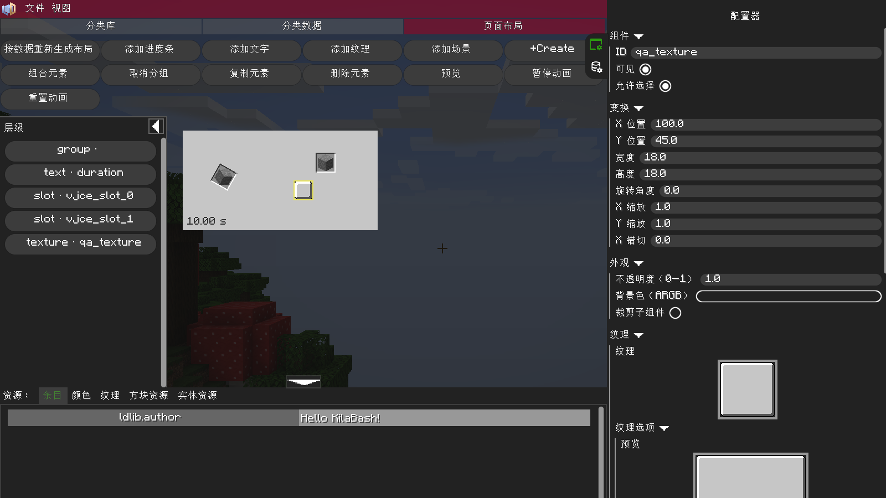

# Visual JEI Category Editor — Forge 1.20.1

游戏内可视化 JEI 分类与展示配方编辑器。此子目录独立维护 Minecraft 1.20.1，使用 Java 17、Forge 和 LDLib1，编辑器与材质资源工作流参考 [MBD2 1.20.1](https://github.com/Low-Drag-MC/Multiblocked2/tree/1.20.1)。仓库根目录是 [1.21.1 NeoForge 工程](../README.md)。



所有修改仅影响客户端 JEI 展示；实际合成和机器配方仍由原模组或配方脚本决定。服务器无需安装 VJCE。

## 安装

| 组件 | 开发依赖 |
| --- | --- |
| Minecraft | 1.20.1 |
| Java | 17 |
| Forge | 47.4.10 |
| LDLib | 1.0.48，Forge 1.20.1 |
| JEI | 15.20.0.105，Forge 1.20.1 |
| Create（可选） | 6.0.6-163 |
| Mekanism（可选） | 1.20.1-10.4.9.61 |
| AE2（可选） | 15.4.12，GuideME 20.1.15 |

将模组 JAR、LDLib 和 JEI 放入客户端 `mods/`。Create 需要其发行包要求的 Flywheel／Ponder；开发客户端固定 Flywheel 1.0.4、Ponder 1.0.80。MBD2 为参考项目，无需安装。

## 使用

1. 进入世界，执行 `/vjce editor`。
2. 从分类库新建分类，或选择现有 JEI 分类。
3. 在“分类数据”中编辑分类、配方、候选原料、数量、概率、催化物和字段。
4. 在“页面布局”中编辑槽位、文字、进度、LDLib1 材质及三维场景。
5. 用 `File → Save` 保存 `.vjce1201` 工程；“保存并应用”写入运行配置，重新进入世界生效。
6. “导出 ZIP”或 `/vjce export` 输出 `exports/vjce-1.20.1-modpack.zip`，解压到目标实例根目录。

分类库、分类数据、场景编辑与弹窗统一使用深色表单；侧栏支持与资源管理器一致的收起动画，视图缩放保留编辑状态，页面布局工作区透明。右侧配置器沿用 MBD2 1.20.1 的 LDLib1 原生样式：深色底、可折叠分组、紧凑同行输入、圆形开关、颜色条和方形纹理预览。底部材质库提供 LDLib1 材质类型、九宫格、组合材质和资源属性面板，可拖入画布。方块资源提供 ID 搜索、预览和合法状态下拉；实体资源提供类型搜索、预览和姿态设置，两者支持高级 NBT。场景支持方块、方块实体、实体、独立动画和世界快照。

| 操作 | 行为 |
| --- | --- |
| 左键 | 仅选择 |
| Shift＋左键拖动 | 移动组件并吸附 |
| Ctrl＋单击 | 进入绿色变换框 |
| 绿色框边缘／八个控制点拖动 | 调整布局宽高；Ctrl＋拖角保持比例 |
| Alt＋绿色框内部拖动 | 旋转；Shift 以 15° 吸附 |
| 变换过程中按 Alt | 暂停位置吸附 |
| 层级树 Ctrl／Shift＋单击 | 切换多选／同级范围选择 |
| Alt＋单击 | 循环选择重叠组件 |
| Ctrl＋G／Ctrl＋Shift＋G | 分组／取消分组 |
| Ctrl＋D／Delete | 复制／删除 |
| Ctrl＋Z／Ctrl＋Shift＋Z | 撤销／重做 |
| 空白左拖／中键拖动／滚轮 | 平移／平移／以鼠标为锚点缩放 |
| Esc | 取消当前手势；再按退出绿色框 |

场景编辑：左键选择、右键环绕、中键平移、滚轮缩放，G／R／S 进行移动／旋转／缩放，X／Y／Z 限定轴，Enter 提交手势，Esc 取消。世界框选保留全屏对话框，使用 MBD2 式自由相机：按住右键转向，配合 W/A/S/D/Q/E 移动、Shift 加速，按住右键滚轮调速。Shift＋左键交替选择两个角点，也可编辑两行 XYZ 坐标。场景半径控制预览范围，右侧参数栏可以隐藏。

原料选择器沿用 JEI 的搜索规则和配置，支持 `@模组`、组合、排除、或条件和短语，输入独立于 JEI 主搜索框。页面布局默认显示可切换的 JEI 单配方参照外框，标出准确原点和宽高；随画布平移缩放，独立于组件变换，不参与导出。

原料类型从当前 JEI 注册列表选择；切换后选定对应类型的原料才会替换数据，关闭选择器保留原值。
未加载模组的旧类型标记为“不可用”并保留数据。槽位角色、绑定属性及其他枚举使用列表选择。

配方数据的三个添加按钮同一行等宽排列，当前配方在两个列表中同步变绿；槽位配置器使用单条外层滚动条。资源栏、页面侧栏和全局配置器收起时，内容随动画补满空间，保留编辑内容和视角；右侧配置器左上角提供常驻箭头。

## 工程与兼容

- 工程后缀为 `.vjce1201`，配置位于 `config/vjce-1.20.1/categories/`。
- 此版本不导入 1.21.1 的 LDLib2 工程。仓库根目录的 1.21.1 工程保持独立。
- 原生分类保留 JEI 原料检索与焦点关联。仅改布局继续使用原生配方填充；覆盖展示原料后禁用填充。
- 特殊控件无法安全拆解时保留只读原页；第三方配方新增能力取决于对应适配。
- 世界快照最多 4096 个方块、32 个实体、每轴 32 格，仅包含客户端已同步的数据。
- 示例：将 [examples/config/](examples/config/) 复制到实例根目录。

## 开发

先进入本目录，并选择 JDK 17。下列命令均在 `forge-1.20.1/` 内执行：

```powershell
.\gradlew.bat build
.\gradlew.bat runClient
.\gradlew.bat runClient -PuiTest=all
.\gradlew.bat runClient -PuiTest=picker
.\gradlew.bat runClient -PuiTest=panels
.\gradlew.bat runClient -PuiTest=choices
.\gradlew.bat runClient -PuiTest=all -PwithCreate=true -PwithMekanism=true -PwithAe2=true
```

产物在 `build/libs/`。客户端验证输出在 `build/ui-test/`，验收失败会让 `runClient` 任务失败，详细结果见 `report.json` 的 `passed` 和 `exit-code.txt`。分类审计输出在 `run/vjce-category-audit.json`。

[进阶指南](docs/GUIDE.zh-CN.md) · [许可证](LICENSE)

## English

This standalone subdirectory ports VJCE to Minecraft 1.20.1, Forge 47.4.10, Java 17, LDLib 1.0.48 and JEI 15.20.0.105. Its editor and texture resources follow the LDLib1 workflow used by MBD2 1.20.1. The [repository root](../README.md) contains the separate 1.21.1 NeoForge project.

Run `/vjce editor` in a world. Create or import a category, edit recipe data and canvas layouts, then save a `.vjce1201` project. Publish the configuration and re-enter the world to apply it. `/vjce export` creates an archive to extract at the destination instance root.

Texture resources use LDLib1 texture types and property editors. Canvas elements support transforms, groups, bindings and opacity. Scene tabs support blocks, block entities, entities and read-only world snapshots. Optional adapters cover Create and Mekanism. Actual server recipes are unaffected. Existing 1.21.1 projects are not imported.

Ingredient types come from the current JEI registry. Changing a type opens a picker limited to that type; selecting a result commits the complete replacement, while cancelling preserves the original. Unavailable types retain their original data and display an unavailable label. Slot roles, binding properties and enum parameters use dropdowns.

Build with JDK 17 from this directory using the commands above. Run `runClient -PuiTest=choices` for the form selection checks. See the client reports for the exact validation outcome.
